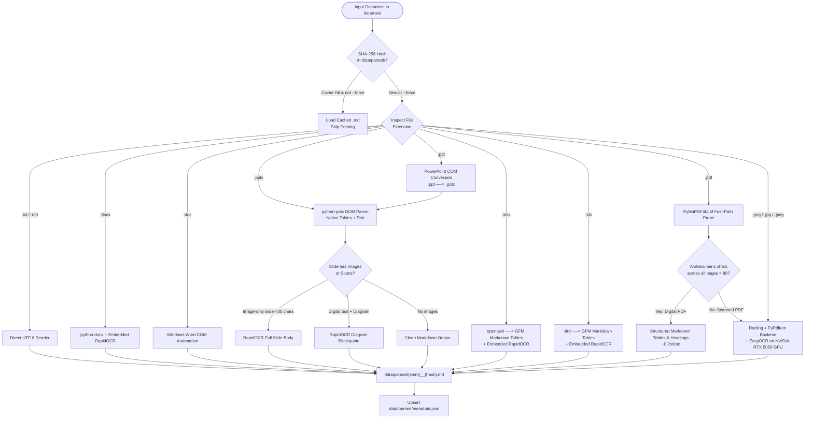
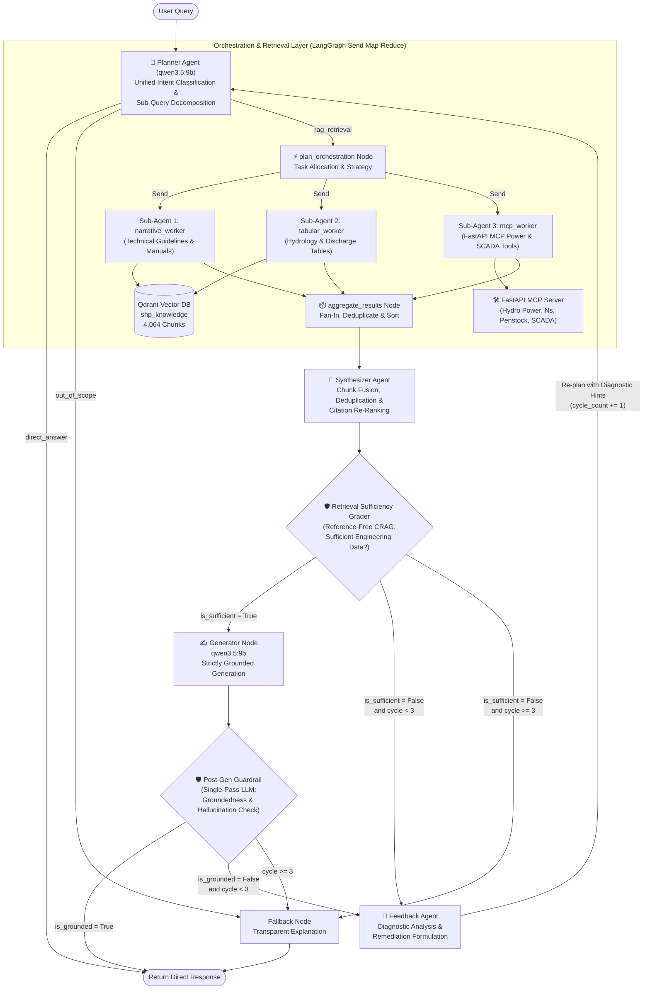

# Agentic RAG — Small Hydropower Plant (SHP) Knowledge System

> An **enterprise-grade, cost-effective Agentic RAG pipeline** for Small Hydropower Plant (SHP) operations, maintenance & knowledge management — built with **LangGraph**, **LangChain**, **Ollama**, and developed using **Spec-Driven Development (SDD)** principles. Fully on-prem capable, no external LLM API dependency.

---

## 📋 Table of Contents

- [1. Overview & Vision](#1-overview--vision)
- [2. Spec-Driven Development (SDD) Methodology](#2-spec-driven-development-sdd-methodology)
- [3. Specifications (The Specs)](#3-specifications-the-specs)
  - [Spec 01: System Requirements & Objectives](#spec-01-system-requirements--objectives)
  - [Spec 02: State Schema & Data Models](#spec-02-state-schema--data-models)
  - [Spec 03: Graph Topology & Node Contracts](#spec-03-graph-topology--node-contracts)
  - [Spec 04: Tools, Retrievers & Integrations](#spec-04-tools-retrievers--integrations)
  - [Spec 05: Guardrails, Fallbacks & Quality Checks](#spec-05-guardrails-fallbacks--quality-checks)
  - [Spec 06: Evaluation & Acceptance Criteria](#spec-06-evaluation--acceptance-criteria)
  - [Spec 06.1: Hardware Performance & Scaling (RTX 5050 vs Production GPUs)](#spec-061-hardware-performance--scaling-rtx-5050-vs-production-gpus)
- [4. Multi-Tier Document Parsing Pipeline](#4-multi-tier-document-parsing-pipeline)
- [5. System Architecture & Workflow](#5-system-architecture--workflow)
  - [5.1 Model Context Protocol (MCP) Server](#51-model-context-protocol-mcp-server-srcmcp_server)
- [6. Project Directory Structure](#6-project-directory-structure)
- [7. Setup & Installation](#7-setup--installation)
- [8. Configuration (.env)](#8-configuration-env)
- [9. Development Roadmap](#9-development-roadmap)

---

## 1. Overview & Vision

| Field | Detail |
| :--- | :--- |
| **Goal** | Build an enterprise-grade, cost-effective Agentic RAG pipeline deployable fully on-prem or on any cloud infrastructure — no external LLM API required. |
| **Target Domain** | Small Hydropower Plant (SHP) — operations, maintenance, fault diagnosis & knowledge management. |
| **Data Scale** | ~2 GB corpus: PDF manuals, Word reports, scanned images, plain text, JPEG/PNG drawings. |
| **LLM** | `qwen3:9b` via **Ollama** (local inference, fully air-gapped capable) |
| **Embedding Model** | `Qwen3-Embedding-0.6B` (local, via Ollama or sentence-transformers) |
| **Vector DB** | **QDrant** (self-hosted, persistent, production-grade) |
| **Document Parsing** | **Multi-Tier Smart Parser** — `pymupdf4llm` + `Docling` GPU Vision OCR + `RapidOCR` + Office DOM (`python-pptx`, `python-docx`, `openpyxl`, `xlrd`) |
| **Orchestration** | **LangGraph** (stateful multi-agent graph) + **LangChain** (chains, retrievers, tools) |
| **Language** | Python 3.11+ |
| **Key Capabilities** | Self-healing retries, corrective RAG (CRAG), self-RAG, query rewriting, hallucination detection, multi-agent routing |
| **Evaluation** | **Deepeval** — LLM evaluation framework (faithfulness, answer relevance, context precision/recall) |

---

## 2. Spec-Driven Development (SDD) Methodology

This project follows **Spec-Driven Development (SDD)**: every node, state transition, tool behavior, and routing condition is written as an explicit, frozen contract *before* any code is implemented.

```
┌─────────────────┐       ┌────────────────────┐       ┌───────────────────┐
│  1. SPEC PHASE  │ ───>  │ 2. BUILD PHASE     │ ───>  │ 3. VERIFY PHASE   │
│  State, Graph & │       │ Implement against  │       │ Evals & Tracing   │
│  Node Contracts │       │ frozen contracts   │       │ against metrics   │
\─────────────────/       \────────────────────/       \───────────────────/
```

1. **Specify** — Define typed state schemas, node input/output contracts, and all routing conditions in this README. **Nothing is built until the spec is signed off.**
2. **Implement** — Build discrete LangGraph nodes that strictly match the written contract. No scope creep.
3. **Verify** — Run automated Deepeval evaluations and traces to validate every node against acceptance criteria.

> **Rule**: If a behavior is not in the spec, it is not built. If the spec is wrong, the spec is updated first, then the code.

---

## 3. Specifications (The Specs)

### Spec 01: System Requirements & Objectives

#### Functional Requirements

| # | Requirement | Status |
|---|---|---|
| FR-01 | Ingest & parse PDF (native + scanned OCR), DOCX/DOC, PPTX/PPT, XLSX/XLS, TXT, PNG/JPG → Markdown | [x] Operational (54/54 docs, 0 failures) |
| FR-02 | Chunk Markdown into semantic segments and embed with `Qwen3-Embedding-0.6B` | [x] Operational (4,064 chunks, 1024-dim vectors) |
| FR-03 | Store & retrieve vectors from self-hosted QDrant with metadata filtering | [x] Operational (4,064 points, dual-mode engine) |
| FR-04 | **Planner Agent**: Unified Intent Classification (`direct_answer` / `out_of_scope` / `rag_retrieval`), Domain-Specific Query Elaboration for high-level prompts, Dynamic Sub-Query Decomposition (1–3 focused sub-queries or atomic single sub-query) with Metadata Filters, and Feedback Absorption | [x] Operational (src/agents/planner/) |
| FR-05 | **Orchestrator Agent & Sub-Agents**: Dynamic Map-Reduce dispatch (`Send`) of specialized sub-agents (`narrative_worker`, `tabular_worker`, `mcp_worker`) | [x] Operational (src/agents/orchestrator/) |
| FR-06 | **Synthesizer Agent**: Multi-source chunk fusion, deduplication, fair-share sub-query balancing, citation packaging, and conflict detection | [x] Operational (src/agents/synthesizer/) |
| FR-07 | **Retrieval Sufficiency Grader (Production CRAG)**: Zero-reference retrieval sufficiency and relevance evaluator using `qwen3.5:9b`. Validates whether synthesized context contains complete engineering facts, parameters, and formulas to answer the user query and planned sub-queries before generation | [x] Operational (src/agents/retrieval_grader/) |
| FR-07-QA | **Offline Retrieval Benchmark Harness (DeepEval)**: Offline QA benchmarking tool measuring Contextual Precision and Contextual Recall against curated golden reference answers (`expected_output`) for regression testing | [x] Operational (src/utils/deepeval_evaluator.py) |
| FR-08 | **Generator Node**: Grounded final answer generation using `qwen3.5:9b`, multi-source evidence synthesis, and inline citation anchoring | [x] Operational (src/agents/generator/) |
| FR-09 | **Post-Generation Guardrail (DeepEval)**: Reference-free Faithfulness & Hallucination detection using `FaithfulnessMetric` and `qwen3.5:9b`. Validates every claim against context; passes unfaithful statements to Feedback Agent upon failure | [x] Operational (src/agents/generation_guardrail/) |
| FR-10 | **Feedback Agent**: Diagnostic reflection on retrieval or generation defects, formulating actionable remediation hints for the Planner Agent and advancing cycle count (loops back if cycle < 3, routes to fallback if cycle >= 3) | [x] Operational (src/agents/feedback/) |
| FR-11 | **Fallback Circuit Breaker**: Graceful cannot-answer response upon exceeding max retry cycles (3). Features 3-tier recovery: extracts best-effort LLM generation with engineering disclaimers, surfaces partial verified chunk evidence, or provides clear notice when data is unavailable in uploaded documents | [x] Operational (src/agents/fallback/) |
| FR-12 | **Session Conversation Memory**: In-Memory `MemorySaver` checkpointing across turns (upgradeable to SQLite for persistent auditing) | [x] Operational (src/agents/main_agent.py) |

#### Non-Functional Requirements

| # | Requirement | Target |
|---|---|---|
| NFR-01 | End-to-end query latency (p95) | < 5.0s on CPU/local GPU |
| NFR-02 | Faithfulness score (Deepeval) | > 0.90 |
| NFR-03 | Answer Relevance score (Deepeval) | > 0.88 |
| NFR-04 | Context Recall (Deepeval) | > 0.85 |
| NFR-05 | Zero dependency on external LLM APIs | ✅ Ollama only |
| NFR-06 | All data stays on-prem; no telemetry | ✅ Air-gap ready |
| NFR-07 | Max query rewrite attempts before fallback | 3 |

---

### Spec 02: State Schema & Data Models

The `AgentState` TypedDict is the **single source of truth** flowing through the entire LangGraph state channel. All nodes read from and write to this state.

```python
# FILE: src/graph/state.py  — FROZEN SPEC (Multi-Agent Architecture)
from typing import Annotated, Any, Literal
from langchain_core.messages import BaseMessage
from langgraph.graph.message import add_messages
from typing_extensions import TypedDict


class DocumentChunk(TypedDict):
    """Represents a single retrieved document chunk with rich citation metadata."""
    chunk_id: str                     # Unique deterministic chunk UUID/string
    content: str                      # Full markdown text of the chunk (with breadcrumbs)
    source_file: str                  # Source filename (e.g. HDP_AHN511.ppt)
    file_type: str                    # Document type (PDF, PPT, DOCX, XLS)
    page_or_slide: int | None         # Page number or slide index
    breadcrumb: str                   # Section path (e.g. Doc > Section > Table)
    is_table: bool                    # Flag indicating structured table data
    score: float                      # Qdrant cosine similarity score


class SubQuery(TypedDict):
    """A decomposed sub-query planned for targeted retrieval."""
    sub_query_id: str                 # Identifier (e.g. "sq_1")
    query_text: str                   # Specific search query
    target_filter: dict[str, Any] | None # Qdrant filter (e.g. {"is_table": "true"})
    rationale: str                    # Why this sub-query was formed


class FeedbackDiagnosis(TypedDict):
    """Structured diagnostic generated by Feedback Agent upon guardrail failure."""
    failure_type: Literal[
        "INSUFFICIENT_RETRIEVAL",      # Low context recall/precision
        "HALLUCINATION_DETECTED",     # Answer contains ungrounded claims
        "OFF_TOPIC_ANSWER"            # Low answer relevancy
    ]
    missing_aspects: list[str]        # Specific engineering facts/tables missing
    critique: str                     # Human-readable explanation of the defect
    remediation_hint: str             # Actionable suggestion for the Planner Agent


class AgentState(TypedDict):
    # ── Core Conversation ──────────────────────────────────────────────
    messages: Annotated[list[BaseMessage], add_messages]  # Chat message history
    query: str                                             # Current active user query
    original_query: str                                    # Unmodified user input

    # ── Planner Decision & Intent ──────────────────────────────────────
    routing_decision: Literal[
        "rag_retrieval",              # Complex technical SHP question requiring RAG
        "direct_answer",              # Conversational greeting or simple factual question
        "out_of_scope"                # Non-SHP / disallowed domain query
    ]

    # ── Planning & Multi-Agent Orchestration ───────────────────────────
    plan: list[str]                   # High-level steps formulated by Planner Agent
    sub_queries: list[SubQuery]       # Decomposed queries for sub-agents
    sub_agent_results: dict[str, list[DocumentChunk]] # Results keyed by sub_query_id

    # ── Synthesis & Fusion ─────────────────────────────────────────────
    documents: list[DocumentChunk]    # Deduplicated, synthesized, and re-ranked chunks
    synthesized_context: str          # Clean context block assembled for LLM generation
    executive_summary: str | None     # High-level technical briefing across all sub-queries
    conflicts_detected: list[str] | None # Cross-document discrepancies or conflicting parameters flagged

    # ── Retrieval Quality & Sufficiency Grader (Production CRAG) ───────
    is_retrieval_sufficient: bool     # True if retrieved context has sufficient data to answer query
    missing_aspects: list[str]        # Specific missing engineering parameters or topics if insufficient
    retrieval_critique: str           # Detailed reasoning explaining sufficiency or deficit
    retrieval_confidence: float | None# Confidence score (0.0 to 1.0)
    retrieval_metrics: dict[str, float] | None # Offline DeepEval metrics {"precision": ..., "recall": ...} during benchmarking

    # ── Post-Generation Guardrail & Faithfulness ───────────────────────
    generation_metrics: dict[str, float]# {"faithfulness": 0.94, "answer_relevancy": 0.92}
    is_grounded: bool                 # True if post-gen faithfulness passes threshold

    # ── Feedback & Self-Correction Loop ────────────────────────────────
    feedback_diagnosis: FeedbackDiagnosis | None # Analysis fed back to Planner
    cycle_count: int                  # Number of full plan-retrieve-evaluate loops (max: 3)

    # ── Final Output ───────────────────────────────────────────────────
    final_response: str               # Final verified answer returned to user
```

---

### Spec 03: Graph Topology & Node Contracts

#### Node Contracts

| Node | Type / Role | Input Fields (State) | Output Fields (State) | Responsibilities & Fallback |
| :--- | :--- | :--- | :--- | :--- |
| `planner` | **Planner Agent** | `query`, `feedback_diagnosis`, `cycle_count` | `routing_decision`, `plan`, `sub_queries`, `final_response` | Unified entry point: classifies intent (`direct_answer`/`out_of_scope`/`rag_retrieval`), elaborates high-level queries with domain concepts while preserving intent, decomposes technical queries into 1–3 `SubQuery` specs (or 1 atomic sub-query if indivisible) with metadata filters, incorporates feedback diagnostics. |
| `plan_orchestration` | **Orchestrator Agent** | `user_query`, `sub_queries` | `tasks`, `coordination_strategy` | Formulates worker tasks; dynamically spawns specialized sub-agents via LangGraph's `Send()` API. |
| `narrative_worker` | Sub-Agent (Manuals) | `task` (via `Send`) | `sub_agent_results`, `all_retrieved_chunks` | Dense semantic retrieval over turbine principles, guidelines, and maintenance text in Qdrant (`filter: is_table=false`). |
| `tabular_worker` | Sub-Agent (Tables) | `task` (via `Send`) | `sub_agent_results`, `all_retrieved_chunks` | Structured retrieval over monthly discharge, head-flow matrices, and cost tables in Qdrant (`filter: is_table=true`). |
| `mcp_worker` | Sub-Agent (Tools/SCADA)| `task` (via `Send`) | `sub_agent_results`, `all_retrieved_chunks` | Exact formula execution ($P$, $N_s$, Penstock sizing) and plant sensor telemetry via FastAPI MCP Server. |
| `aggregate_results` | Fan-In Aggregator | `all_retrieved_chunks`, `sub_agent_results` | `all_retrieved_chunks`, `total_retrieved` | Fans in outputs across all dynamic sub-agents, deduplicates by `chunk_id`, and sorts by relevance score. |
| `synthesizer` | **Synthesizer Agent** | `sub_agent_results`, `all_retrieved_chunks`, `query` / `user_query`, `sub_queries` | `documents`, `synthesized_context`, `executive_summary`, `conflicts_detected`, `citations` | Fuses chunks across all sub-queries, eliminates duplicates by `chunk_id`, enforces fair-share sub-query coverage, elevates MCP tool calculations, and assembles structured, citation-anchored context. Features high-speed pure-Python deterministic fusion (0.000s) to eliminate redundant LLM generation cycles and preserve VRAM/bandwidth on local GPUs. |
| `retrieval_grader` | **Retrieval Sufficiency Grader** (Production CRAG) | `query`, `sub_queries`, `synthesized_context`, `documents` | `is_retrieval_sufficient`, `missing_aspects`, `retrieval_critique`, `retrieval_confidence` | Zero-reference evaluator using `qwen3.5:9b`. Analyzes whether synthesized context contains all required technical parameters, formulas, equipment curves, and operational facts to answer the user query and sub-queries. If sufficient → `generator`. If insufficient and `cycle_count < 3` → `feedback_agent`. If insufficient and `cycle_count >= 3` → `fallback`. |
| `generator` | Answer Generator | `query`, `synthesized_context` | `final_response` | Synthesizes an authoritative engineering answer strictly from context using `qwen3.5:9b`. |
| `generation_guardrail` | Post-Gen Evaluator | `query`, `final_response`, `documents` | `generation_metrics`, `is_grounded` | Evaluates Faithfulness and Hallucination metrics. If ungrounded → routes to `feedback_agent`. |
| `feedback_agent` | **Feedback Agent** | `query`, `retrieval_metrics`, `generation_metrics`, `cycle_count`, `missing_aspects`, `retrieval_critique` | `feedback_diagnosis`, `cycle_count` | Diagnoses defect root cause, formulates actionable query remediation, increments `cycle_count`. If `cycle_count >= 3` → routes to `fallback`. |
| `fallback` | **Fallback Circuit Breaker** (FR-11) | `original_query` / `query`, `routing_decision`, `cycle_count`, `final_response`, `documents`, `feedback_diagnosis`, `missing_aspects`, `unfaithful_statements` | `final_response`, `circuit_breaker_tripped` | Transparent fail-safe terminal node. Activated when retries reach max limit (`cycle_count >= 3`) or query is out-of-scope. Employs 3-tier response generation: (1) extracts best-effort LLM generation with high-visibility engineering warning & disclaimer, (2) formats partial verified chunk evidence if generation was bypassed, or (3) clarifies that the specific data is unavailable in uploaded documents with required ingestion guidance. |

#### Routing & Conditional Edges

```
START                     ──> planner

planner → "direct_answer" ──> END (returns direct answer immediately)
planner → "out_of_scope"  ──> fallback (returns polite domain refusal)
planner → "rag_retrieval" ──> plan_orchestration

plan_orchestration ──(Send)──> narrative_worker ──> aggregate_results
plan_orchestration ──(Send)──> tabular_worker   ──> aggregate_results
plan_orchestration ──(Send)──> mcp_worker       ──> aggregate_results

aggregate_results         ──> synthesizer
synthesizer               ──> retrieval_grader

retrieval_grader → is_retrieval_sufficient = True                     ──> generator
retrieval_grader → is_retrieval_sufficient = False AND cycle_count < 3 ──> feedback_agent
retrieval_grader → is_retrieval_sufficient = False AND cycle_count >= 3 ──> fallback

generator                 ──> generation_guardrail

generation_guardrail → is_grounded = True                            ──> END (Return response)
generation_guardrail → is_grounded = False AND cycle_count < 3      ──> feedback_agent
generation_guardrail → is_grounded = False AND cycle_count >= 3     ──> fallback

feedback_agent            ──> planner (re-plan with diagnostic guidance)
```

---

### Spec 04: Tools, Retrievers & Integrations

| Component | Choice | Config |
| :--- | :--- | :--- |
| **LLM** | `qwen3.5:9b` via Ollama | `base_url: http://localhost:11434`, `temperature: 0.0` for graders, `0.3` for generation |

| **Embedding Model** | `Qwen3-Embedding-0.6B` via Ollama | `model: qwen3-embedding:0.6b`, `dim: 1024` |
| **Vector Store** | QDrant (self-hosted) | `host: localhost`, `port: 6333`, `collection: shp_knowledge` |
| **Document Parser** | Docling | Input: PDF, DOCX, TXT, JPEG, PNG → Output: Markdown |
| **Text Splitter** | `RecursiveCharacterTextSplitter` (Markdown-aware) | `chunk_size: 1000`, `chunk_overlap: 150` |
| **Retriever** | QDrant vector search | `top_k: 6`, `score_threshold: 0.65` |
| **Checkpointing** | LangGraph `MemorySaver` (In-Memory RAM for active session); upgradeable to `SqliteSaver` (`./data/checkpoints.db`) | In-RAM thread checkpointing during session execution; zero disk overhead; persistent cross-session audit tracing via SQLite |
| **MCP Tool Server** | FastAPI SHP MCP Server (`src/mcp_server/`) | Port 8000 (FastAPI + Uvicorn): JSON-RPC 2.0 (`/mcp`), REST endpoints (`/tools`, `/api/v1/...`), Swagger UI (`/docs`) |

---

### Spec 05: Guardrails, Quality Checks & Feedback Agent

#### 1. Production Retrieval Sufficiency & Relevance Grader (Reference-Free CRAG)
- **Module**: `src/agents/retrieval_grader/`
- **Role**: **Runtime Pre-Generation Gatekeeper** in the live production LangGraph workflow.
- **Mechanism**: LLM-as-judge using `qwen3.5:9b` executing **Reference-Free Corrective RAG (CRAG)** grading.
- **Why Reference-Free**: In live production, unseen end-user queries do not have known ground-truth answers. The system cannot rely on reference answers to determine if retrieval succeeded. Instead, the Grader inspects the user query, planned sub-queries, and synthesized context to evaluate whether all technical dimensions and data points are present to formulate a complete answer.
- **Inputs**:
  - `query`: The user's primary engineering query.
  - `sub_queries`: Decomposed technical sub-queries with targets and rationales from the Planner.
  - `synthesized_context`: Clean context block assembled by the Synthesizer Agent (including tables, narrative chunks, and MCP calculations).
- **Grading Dimensions**:
  1. **Technical Sufficiency**: Does the context contain the specific formulas, equipment ratings, head/flow ranges, or site data required?
  2. **Sub-Query Coverage**: Are all sub-queries planned by the Planner Agent addressed by the retrieved evidence?
  3. **Relevance & Signal-to-Noise**: Is the context technically relevant to Small Hydropower engineering, rather than generic filler?
- **Outputs**: Structured Pydantic `RetrievalGraderOutput`:
  ```json
  {
    "is_sufficient": true,
    "missing_aspects": [],
    "critique": "Retrieved context thoroughly provides net head (120m), discharge requirements, and efficiency curves for both Pelton and Francis turbines.",
    "confidence_score": 0.95
  }
  ```
- **Decision Contract**:
  - If `is_retrieval_sufficient == True` → Route to `generator` node.
  - If `is_retrieval_sufficient == False` AND `cycle_count < 3` → Route to `feedback_agent` with `missing_aspects` and `critique`.
  - If `is_retrieval_sufficient == False` AND `cycle_count >= 3` → Route to `fallback` (circuit breaker).

#### 2. Offline Retrieval Benchmark Harness (DeepEval Precision & Recall)
- **Module**: `src/utils/deepeval_evaluator.py`
- **Role**: **Offline QA & Regression Testing Suite** for evaluation against curated golden datasets.
- **Mechanism**: DeepEval (`ContextualPrecisionMetric`, `ContextualRecallMetric`) powered by local Ollama (`qwen3.5:9b`) via `OllamaDeepEvalModel(DeepEvalBaseLLM)` with zero cloud dependencies.
- **Requirement**: Requires a **ground-truth reference answer (`expected_output`)** for each query in the evaluation dataset.
- **Intended Usage**:
  - **For QA Engineers & Testers**: Systematically benchmarks vector index retrieval quality, chunking strategies, and re-ranking performance.
  - **Not in Live Production Workflow**: Because production queries have no known reference answer, this harness is executed independently during CI/CD or offline regression testing.
- **Evaluated Metrics**:
  - `Contextual Precision` (Threshold ≥ 0.85):
    $$\text{Precision} = \frac{\text{Relevant Chunks Retrieved}}{\text{Total Chunks Retrieved}}$$
    *Meaning*: Of all the chunks the retriever returned, how many were actually relevant? High precision prevents polluting the LLM context with irrelevant noise. DeepEval's metric also weights rank position to ensure the most critical evidence is ranked at the very top.
  - `Contextual Recall` (Threshold ≥ 0.85):
    $$\text{Recall} = \frac{\text{Relevant Chunks Retrieved}}{\text{Total Relevant Chunks Existing in Knowledge Base}}$$
    *Meaning*: Of all the relevant chunks that exist in the knowledge base to answer the query, how many did the retriever successfully locate? Evaluated against the golden reference answer by verifying whether all facts in `expected_output` are covered by the retrieved chunks.

#### 3. Post-Generation Guardrail (Single-Pass Groundedness Evaluation at Runtime)
- **Module**: `src/agents/generation_guardrail/`
- **Role**: **Runtime Post-Generation Gatekeeper** validating answer faithfulness and eliminating hallucinations before delivery.
- **Mechanism (Runtime)**: High-speed, **Single-Pass Local LLM Judge (`qwen3.5:9b`)** via Jinja2 templates (`src/prompts/generation_guardrail_*.jinja2`) with constrained token prediction (`num_predict=512`). Evaluates factual consistency across numbers, formulas, and turbine specifications in **one single inference (~5–10 seconds)** rather than multi-minute claim-by-claim loops.
- **Offline Benchmarking Integration**: DeepEval's full multi-step `FaithfulnessMetric` and `ContextualRecallMetric` are maintained in `src/evals/run_deepeval.py` for comprehensive offline evaluation against the 52-case golden dataset.
- **Why Reference-Free (Runs in Production)**: Unlike retrieval recall metrics that require a golden reference answer (`expected_output`), faithfulness evaluation checks `actual_output` strictly against `synthesized_context` (the retrieved evidence dossier). It requires zero ground-truth answers and operates seamlessly at live inference time.
- **Inputs**: `query` + `final_response` + `synthesized_context` (or `documents`).
- **Evaluated Metric**:
  - `Faithfulness` (Threshold ≥ 0.90):
    $$\text{Faithfulness} = \frac{\text{Factual Claims in Answer Supported by Context}}{\text{Total Factual Claims Made in Answer}}$$
    *Meaning*: Of all factual claims, formulas, ratings, and numbers in the generated response, how many are strictly supported by the retrieved context? Directly measures hallucination prevention ($\text{Hallucination Rate} = 1 - \text{Faithfulness}$).
- **Outputs**: Pydantic structured `GenerationGuardrailOutput` (`is_grounded`, `faithfulness_score`, `unfaithful_statements`, `critique`).
- **Decision Contract**:
  - If Faithfulness ≥ 0.90 → `is_grounded = True` → Route to `END` (deliver verified answer to user).
  - Else → `is_grounded = False` → Passes `unfaithful_statements` and critique to `feedback_agent` for diagnostic re-planning.

#### 4. Feedback Agent (Reflection & Remediation Loop)
- **Module**: `src/agents/feedback/`
- **Role**: Rather than a blind retry, the Feedback Agent acts as an intelligent diagnostic inspector whenever the **Retrieval Sufficiency Grader** or **Post-Generation Guardrail** rejects a run.
- **Inputs**:
  - `query`: Current engineering query.
  - Pre-Gen Failure Inputs (from `retrieval_grader`): `is_retrieval_sufficient: False`, `missing_aspects: list[str]`, `retrieval_critique: str`.
  - Post-Gen Failure Inputs (from `generation_guardrail`): `is_grounded: False`, `generation_metrics: dict`, `final_response: str`.
  - `cycle_count`: Current loop execution count.
- **Diagnostic Logic & Loop Back**:
  1. **Dual Failure Detection**:
     - If triggered after `retrieval_grader` $\to$ sets `failure_type = "INSUFFICIENT_RETRIEVAL"`, packages `missing_aspects`, and writes a targeted `remediation_hint` for the Planner Agent.
     - If triggered after `generation_guardrail` $\to$ sets `failure_type = "HALLUCINATION_DETECTED"` or `"OFF_TOPIC_ANSWER"`, identifies unverified statements, and directs the Planner or Generator on how to constrain claims.
  2. **Cycle Advancement & Loop Control**:
     - Increments `cycle_count` by 1 (`cycle_count + 1`).
     - **If `cycle_count < 3`**: Passes `feedback_diagnosis` back to the `planner` node. The Planner Agent absorbs the diagnosis, modifies search terms, adds missing formulas or technical parameters, adjusts Qdrant metadata filters (`is_table`), or allocates the MCP tool worker.
     - **If `cycle_count >= 3`**: The circuit breaker trips and routes to `fallback` (graceful refusal with full transparency on what data was missing).
- **Outputs**: Structured Pydantic `FeedbackDiagnosis`:
  ```json
  {
    "failure_type": "INSUFFICIENT_RETRIEVAL | HALLUCINATION_DETECTED | OFF_TOPIC_ANSWER",
    "missing_aspects": [
      "Sarkaria formula for economic penstock diameter calculation",
      "Penstock shell wall thickness equations (IS 11639 / ASCE)"
    ],
    "critique": "Retrieved context only covered civil intake structures and lacked penstock hydraulic sizing data.",
    "remediation_hint": "Decompose into a dedicated sub-query for penstock diameter using calculate_penstock_diameter MCP tool and a narrative sub-query for steel plate thickness.",
    "target_recommendations": [
      "mcp_worker:calculate_penstock_diameter",
      "narrative_retriever"
    ]
  }
  ```


---

### Spec 06: Evaluation & Acceptance Criteria

#### Evaluation Framework
- **Primary**: [Deepeval](https://github.com/confident-ai/deepeval) — LLM evaluation framework with built-in RAG metrics, runs locally
- **Tracing**: LangSmith (optional, for development trace inspection)

#### Deepeval Metrics & Acceptance Criteria

| Metric | DeepEval Class | Target | Mathematical Formula | Core Engineering Meaning |
| :--- | :--- | :--- | :--- | :--- |
| **Retrieval Precision** | `ContextualPrecisionMetric` | ≥ 0.85 | $\frac{\text{Relevant Chunks Retrieved}}{\text{Total Chunks Retrieved}}$ | **Signal-to-Noise Ratio**: Of all chunks the retriever returned, how many were actually relevant? High precision prevents polluting the generation prompt with noise. |
| **Retrieval Recall** | `ContextualRecallMetric` | ≥ 0.85 | $\frac{\text{Relevant Chunks Retrieved}}{\text{Total Relevant Chunks Existing}}$ | **Completeness**: Of all relevant technical facts existing in the knowledge base, how many did the retriever find? (Tested against golden reference answers). |
| **Contextual Relevancy** | `ContextualRelevancyMetric` | ≥ 0.80 | $\frac{\text{Relevant Sentences in Context}}{\text{Total Sentences in Context}}$ | **Information Density**: Assesses whether chunks are dense with useful facts rather than bloated with irrelevant filler text. |
| **Faithfulness** | `FaithfulnessMetric` | ≥ 0.90 | $\frac{\text{Claims Supported by Context}}{\text{Total Factual Claims in Answer}}$ | **Hallucination Prevention**: Are all parameters, formulas, and ratings in the generated answer strictly backed by context? ($\text{Hallucination Rate} = 1 - \text{Faithfulness}$). |
| **Answer Relevancy** | `AnswerRelevancyMetric` | ≥ 0.88 | $\frac{\text{Sentences Addressing Query Intent}}{\text{Total Sentences in Answer}}$ | **Query Adherence**: Does the generated response directly answer the engineering question without drift, omissions, or tangential filler? |
| **Query Latency (p95)**| Custom Timer | < 5.0s | Measured wall-clock time | End-to-end response time on local GPU/CPU. |
| **Fallback Rate** | Custom Counter | < 10% | $\frac{\text{Fallback Invocations}}{\text{Total Executed Queries}}$ | % of queries triggering the circuit breaker due to persistent data gaps. |

#### Acceptance Gate
A build is **not promoted** unless all 7 metrics above meet their targets on the SHP golden test set (minimum 50 hand-labeled `LLMTestCase` objects from the corpus).

```python
# FILE: src/evals/run_deepeval.py — evaluation entry point
from deepeval import evaluate
from deepeval.metrics import (
    FaithfulnessMetric,
    AnswerRelevancyMetric,
    ContextualPrecisionMetric,
    ContextualRecallMetric,
    ContextualRelevancyMetric,
)
from deepeval.test_case import LLMTestCase

METRICS = [
    FaithfulnessMetric(threshold=0.90, model="ollama/qwen3:9b"),
    AnswerRelevancyMetric(threshold=0.88, model="ollama/qwen3:9b"),
    ContextualPrecisionMetric(threshold=0.85, model="ollama/qwen3:9b"),
    ContextualRecallMetric(threshold=0.85, model="ollama/qwen3:9b"),
    ContextualRelevancyMetric(threshold=0.80, model="ollama/qwen3:9b"),
]
```

---

### Spec 06.1: Hardware Performance & Scaling (RTX 5050 vs Production GPUs)

> [!NOTE] Hardware Architecture: Compute vs. Memory Bandwidth
> In transformer autoregressive decoding, token generation speed is strictly **Memory Bandwidth-bound**, not compute-bound. For every single generated token, the GPU must transfer the complete 6.6 GB of `qwen3.5:9b` weights from VRAM across the memory bus to the Tensor Cores. Consequently, generation throughput scales almost linearly with VRAM memory bus speed ($\text{GB/s}$).

#### 1. Baseline Benchmark: NVIDIA GeForce RTX 5050 Laptop GPU (8 GB)
- **VRAM Capacity**: 8.0 GB GDDR6
- **Memory Bus Width**: 128-bit
- **Effective Memory Bandwidth**: $\approx 224\text{ GB/s}$
- **Measured Generation Throughput (`qwen3.5:9b`)**: **12 to 15 tokens/second**
- **Measured Response Latencies**:
  - Direct Conversational Reply (~150 tokens): **~6.6 seconds**
  - Full Technical Engineering Report (~1,050 tokens): **~75 to 85 seconds**
  - Synthesizer Deterministic Fusion (Zero LLM overhead): **0.000 seconds**
  - Single-Pass Groundedness Guardrail (~120 tokens): **~15 to 20 seconds**
- **VRAM Headroom Reality**:
  $$\text{VRAM Usage} \approx 6.6\text{ GB (Model)} + 1.2\text{ GB (8k KV Cache)} + 0.4\text{ GB (CUDA Runtime)} = \mathbf{8.2\text{ GB}}$$
  On an 8 GB GPU, memory is utilized at 100% capacity. When desktop compositing or multi-agent memory spikes occur, slight host paging across the PCIe bus can introduce minor transient latency variations.

#### 2. Production GPU Scaling Matrix (`qwen3.5:9b` Inference)

The table below illustrates how the exact same multi-agent workflow scales as memory bandwidth and VRAM capacity increase on desktop, workstation, and datacenter hardware:

| Hardware Tier | GPU Model | VRAM | Bus Width | Memory Bandwidth | Throughput (`qwen3.5:9b`) | 1,000-Token Report | End-to-End RAG Lifecycle |
| :--- | :--- | :---: | :---: | :---: | :---: | :---: | :---: |
| **Local Baseline (Laptop)** | **GeForce RTX 5050 Laptop** *(Tested)* | **8 GB** | **128-bit** | **224 GB/s** | **~12–15 tok/s** | **~75–85s** | **~1.5–2.5 min** |
| **Mid-Range Desktop** | GeForce RTX 4070 Ti Super | 16 GB | 256-bit | 672 GB/s | ~40–50 tok/s | ~20–25s | ~40–50s |
| **High-End Desktop** | GeForce RTX 4090 | 24 GB | 384-bit | 1,008 GB/s | ~65–80 tok/s | ~12–15s | ~20–25s |
| **Professional Workstation**| RTX 6000 Ada Generation | 48 GB | 384-bit | 960 GB/s | ~70–90 tok/s | ~11–14s | ~18–22s |
| **Datacenter Enterprise** | NVIDIA A100 SXM4 | 80 GB | 5120-bit HBM2e | 2,039 GB/s | ~120–150 tok/s | ~6–8s | ~10–14s |
| **Hyperscale Acceleration**| NVIDIA H100 SXM5 | 80 GB | 5120-bit HBM3 | 3,350 GB/s | ~180–230 tok/s | ~4–5s | ~6–9s |

#### 3. Enterprise Production Benefits on 24 GB / 32 GB / 64 GB+
1. **$5\times$ to $15\times$ Latency Reduction**: Upgrading from a 128-bit mobile bus (224 GB/s) to high-bandwidth memory (1,008 to 3,350 GB/s) drops the total end-to-end multi-agent execution time from **~2 minutes down to 8–15 seconds**.
2. **Zero Host RAM Paging**: 24 GB+ VRAM provides abundant headroom for full 32k context lengths, multi-turn session history, and full FP16 KV caches with zero PCIe bus offloading.
3. **Concurrent Multi-Agent Parallelism**: High-capacity GPUs allow setting `OLLAMA_NUM_PARALLEL=4` (or deploying with vLLM / TensorRT-LLM PagedAttention continuous batching), enabling Planner, Orchestrator, narrative workers, tabular workers, and guardrails to run simultaneously without queue serialization.

---

## 4. Multi-Tier Document Parsing Pipeline (Operational)

The ingestion pipeline ([`src/ingestion/parser.py`](file:///d:/GenAi_Code/Agentic_RAG/src/ingestion/parser.py)) implements an enterprise-grade, **3-tier smart routing architecture** designed to maximize extraction fidelity (preserving Markdown headings, tables, and lists), eliminate OCR hallucination on digital text, and selectively engage GPU/CPU OCR only where visual elements or scans require it.

### Routing Architecture



---

### Format-by-Format Extraction Strategy

| File Type | Extensions | Primary Engine | OCR Engine & Mode | Table Extraction Quality | Speed |
| :--- | :--- | :--- | :--- | :--- | :--- |
| **Digital PDF** | `.pdf` | `pymupdf4llm` (C++ fitz) | Selective (image crops only) | Native GFM Markdown tables (`\| ... \|`) | **~0.2s–0.5s** / doc |
| **Scanned PDF** | `.pdf` | `Docling` (`PyPdfiumDocumentBackend`) | **EasyOCR on CUDA GPU** (NVIDIA RTX 5050, `sm_120`) | Layout transformer table recovery | **~5s–15s** / doc |
| **PowerPoint** | `.pptx`, `.ppt` | `python-pptx` (via COM for `.ppt`) | **RapidOCR** (selective per-image & image-only slides) | Native GFM Markdown tables (`\| ... \|`) | **~1s–5s** / doc |
| **Word Document** | `.docx`, `.doc` | `python-docx` / Word COM | **RapidOCR** (on embedded figures/charts) | Native GFM Markdown tables (`\| ... \|`) | **~0.5s–1.5s** / doc |
| **Excel Workbook** | `.xlsx`, `.xls` | `openpyxl` / `xlrd` | **RapidOCR** (on embedded charts/drawings) | Native GFM Markdown tables (`\| ... \|`) | **~0.05s–0.2s** / doc |
| **Standalone Images** | `.png`, `.jpg`, `.jpeg` | `Docling` / `EasyOCR` | Full-image OCR (GPU/CPU) | Visual table recognition | **~2s–5s** / image |
| **Plain Text** | `.txt`, `.md` | Direct UTF-8 stream | None | Preformatted Markdown | **< 0.01s** |

---

### Detailed Technical Implementations

#### 1. PDFs: Digital Fast-Path with Scanned GPU Fallback
- **Digital Fast-Path**: Uses `pymupdf4llm` to convert digital vector PDFs directly into clean Markdown. Preserves structural headings (`#`, `##`, `###`), bold text, bullet points, and converts vector-drawn and text-delimited tables into standard GitHub-Flavored Markdown tables.
- **Scanned Detection Probe**: Calculates the clean alphanumeric character count across all pages. If fewer than 80 characters are detected, it classifies the file as a scanned document or blueprint and engages the GPU vision pipeline.
- **GPU Docling Vision OCR**:
  - Configured with `PyPdfiumDocumentBackend` (Google Chromium PDFium engine) for native crash-proof stability on Windows.
  - Accelerated via PyTorch CUDA 12.8 (`cu128`) on the **NVIDIA GeForce RTX 5050 Laptop GPU (8GB VRAM, Blackwell `sm_120`)**.
  - Runs vision layout models + EasyOCR for multi-column text restoration and scanned table grid reconstruction.

#### 2. PowerPoint (`.pptx` & `.ppt`): Native Tables + Selective OCR
- **Native Table Integrity**: Extracts structured tables directly from PowerPoint's internal shape tree (`shape.has_table`). Every row and cell is mapped to a Markdown table with header dividers, preserving numeric data (MW, kW, tariffs, flow rates) without OCR distortion.
- **Smart Selective OCR**:
  - **Image-Only Slides**: If a slide contains virtually no digital text (< 30 characters) and no table (e.g. a scanned slide or photograph), RapidOCR transcribes the image and formats the text as the primary slide body.
  - **Embedded Diagrams & Flowcharts**: If a slide has digital text *plus* embedded charts, schematics, or maps, RapidOCR transcribes the visual text and appends it cleanly in a blockquote:
    ```markdown
    > **[Slide 13 Image/Diagram OCR]**: Day of Year NATURAL FLOW PATTERN Flood River Flow Natural High Flows
    ```
- **Legacy `.ppt` COM Bridge**: Uses Windows PowerPoint COM automation (`win32com.client`) in headless mode (`WithWindow=False`) to convert legacy binary `.ppt` files to `.pptx` in-memory before parsing, ensuring legacy presentations receive identical table and text fidelity.

#### 3. Excel Spreadsheets (`.xlsx` & `.xls`): Worksheets to Tables
- **`.xlsx`**: Processed via `openpyxl` with `data_only=True` to capture computed cell values rather than raw formula strings.
- **`.xls`**: Processed via `xlrd` for legacy binary workbooks.
- Converts all active worksheets into dedicated Markdown sections (`## Sheet: SheetName`) followed by GFM Markdown tables with proper column alignment.
- Worksheet drawings and floating chart objects are inspected and OCR'd via RapidOCR.

#### 4. Word Documents (`.docx` & `.doc`):
- Modern `.docx` files extract heading styles, bullet hierarchies, and table grids via `python-docx`. Embedded `r:embed` image streams in document parts are inspected and OCR'd.
- Legacy `.doc` files extract formatted text via Windows Word COM automation (`win32com.client.Dispatch("Word.Application")`).

#### 5. Hardware & Process Optimization:
- **GPU (RTX 5050 via CUDA 12.8)**: Dedicated exclusively to heavy vision models (Docling layout transformers, scanned PDF EasyOCR, and upcoming Qwen3 vector embeddings) to prevent VRAM fragmentation.
- **CPU (Multi-Threaded ONNX Runtime with AVX2)**: RapidOCR (PP-OCRv6 engine, ~15MB weights) runs on multi-core CPU, achieving 0.3s–0.5s per image with zero GPU memory contention.

---

### Ingestion CLI Commands

```powershell
# Parse all supported documents in data/raw/ (skips already-parsed files via SHA-256 cache)
python -m src.ingestion.parser

# Force re-parse all documents (overwriting data/parsed/)
python -m src.ingestion.parser --force

# Force re-parse only PowerPoint presentations
python -m src.ingestion.parser --force --ext .pptx .ppt

# Force re-parse Word and Excel files
python -m src.ingestion.parser --force --ext .docx .doc .xlsx .xls

# Run with custom directories and parallel workers
python -m src.ingestion.parser --raw-dir ./data/raw --parsed-dir ./data/parsed --workers 2
```

---

### Markdown-Aware Semantic Chunking (`src/ingestion/chunker.py`)

The chunking pipeline ([`src/ingestion/chunker.py`](file:///d:/GenAi_Code/Agentic_RAG/src/ingestion/chunker.py)) is specifically engineered for high-precision technical retrieval and optimized for smaller/local LLMs (`qwen3:9b`):

1. **Context Breadcrumb Injection**:
   - Every chunk automatically inherits its complete document hierarchy (e.g. `[Source: Madkini flood peak report.doc | Location: Slide/Page 3 | Section: Flood Frequency Analysis > Gumbel Distribution]`).
   - Prepending this context ensures that local models immediately understand what project, river, or clause a technical excerpt refers to, eliminating retrieval ambiguity.
2. **Atomic Table Protection**:
   - Markdown tables (`| ... |`) are identified and kept unbroken within a single chunk whenever possible.
   - For giant tables exceeding token limits, the table is split row-by-row while **repeating the column header row on every split chunk**, ensuring every chunk remains a valid, readable Markdown table.
3. **Slide Boundary Preservation**:
   - Presentation slides (`## Slide {i}`) are preserved as distinct contextual units.
4. **Token Budgeting via Tiktoken**:
   - Exact token counts are computed using `tiktoken` (`cl100k_base`), maintaining chunks around **~330 tokens** (well within `Qwen3-Embedding-0.6B`'s sweet spot).

#### Chunk Metadata Payload (For Citations)
```json
{
  "chunk_id": "HDP_AHN511__9fe0f668__c0002",
  "source_file": "HDP_AHN511.ppt",
  "file_type": "PPT",
  "document_title": "HDP_AHN511",
  "breadcrumb": "HDP_AHN511 > Slide 1: Dynamic Pricing of electrical power",
  "section_hierarchy": ["HDP_AHN511", "Slide 1: Dynamic Pricing of electrical power"],
  "page_or_slide": 1,
  "chunk_index": 2,
  "total_chunks": 36,
  "is_table": false,
  "char_count": 482,
  "token_count": 121
}
```

#### Chunking CLI Commands
```powershell
# Chunk all parsed documents in data/parsed/ (outputs to data/chunks/chunks.jsonl)
python -m src.ingestion.chunker

# Customize chunk size and overlap
python -m src.ingestion.chunker --max-chars 1800 --overlap-chars 150
```

---

### 4.2 Vector Embedding Pipeline (`qwen3-embedding:0.6b`)

The vector embedding engine ([`src/ingestion/embedder.py`](file:///d:/GenAi_Code/Agentic_RAG/src/ingestion/embedder.py)) translates semantic chunk texts into high-density 1024-dimensional continuous representations using local Ollama.

#### Model Selection Rationale
- **Model**: `qwen3-embedding:0.6b` (639 MB manifest).
- **Vector Dimension**: `1024` floats per vector.
- **VRAM Footprint**: ~640 MB VRAM, co-existing comfortably alongside `qwen3.5:9b` within the 8 GB VRAM budget of the NVIDIA GeForce RTX 5050 Laptop GPU.
- **Multilingual & Domain Breadth**: Outstanding semantic density across technical engineering concepts (hydrology, hydro-mechanical turbine envelopes, civil structures, Indian Central Electricity Authority regulatory guidelines).

#### Technical Specifications & Reliability
1. **Ollama Batch API Endpoint**: Interacts with `http://127.0.0.1:11434/api/embed` passing multi-text arrays (`batch_size=32`), drastically cutting HTTP request overhead compared to single-item endpoints.
2. **Incremental Checkpointing**: Reads existing `data/embeddings/embedded_chunks.jsonl` upon startup; already-embedded `chunk_id`s are skipped automatically, preventing redundant recomputation during interrupted runs.
3. **Resilient Retry Protocol**: Implements exponential backoff retries (`2^attempt` second backoff) to smoothly absorb transient Ollama GPU memory re-allocations.
4. **Execution Performance**:
   - **Total Chunks Embedded**: **4,064**
   - **Throughput**: **21.5 chunks/second** (189.37 seconds total runtime)
   - **Failures / Drops**: **0**

```powershell
# Generate embeddings for all chunks in data/chunks/chunks.jsonl
python -m src.ingestion.embedder --batch-size 32

# Re-embed from scratch (dropping cache)
python -m src.ingestion.embedder --force
```

---

### 4.3 Qdrant Vector Indexing & Hybrid Retrieval Engine

The vector indexer ([`src/ingestion/indexer.py`](file:///d:/GenAi_Code/Agentic_RAG/src/ingestion/indexer.py)) ingests embedded chunks into the `shp_knowledge` Qdrant collection for high-speed similarity search and payload filtering.

#### Architecture Highlights
1. **Zero-Dependency Dual Mode**:
   - **Server Mode**: Probes `http://127.0.0.1:6333`. Connects to a live Qdrant container if running.
   - **Embedded Disk Mode (Fallback)**: If no server daemon is running, seamlessly launches an embedded local disk engine storing data in `data/qdrant_db/`. No Docker or background service required.
2. **Deterministic UUID5 Identifiers**:
   - Every chunk ID (e.g. `HDP_AHN511__9fe0f668__c0002`) maps to a deterministic UUID via `uuid5(NAMESPACE_SHP, chunk_id)`.
   - Guaranteed idempotent upserts: Running indexer repeatedly never generates duplicate points or phantom vectors.
3. **Rich Metadata Payload Indexing**:
   - Payload attributes indexed for pre-filtering: `file_type`, `is_table`, `source_file`, `page_or_slide`.
   - Full citation text preserved: `content`, `breadcrumb`, `document_title`, `token_count`.
4. **Indexing Benchmarks**:
   - **Total Indexed Points**: **4,064**
   - **Upsert Speed**: **199.3 points/second** (completed in 20.39 seconds)
   - **Distance Metric**: **Cosine**

#### CLI & Verification Commands
```powershell
# Index embedded chunks into Qdrant collection 'shp_knowledge'
python -m src.ingestion.indexer --batch-size 128

# Recreate collection from scratch
python -m src.ingestion.indexer --recreate

# Test semantic query retrieval with top-3 formatted citations
python -m src.ingestion.indexer --query "Kaplan turbine efficiency curve and cavitation limits" --top-k 3

# Test structured table-only filtering
python -m src.ingestion.indexer --query "hydrological discharge flow data" --filter-table --top-k 3
```

---

## 5. System Architecture & Workflow

The architecture operates as a **Plan-Orchestrate-Synthesize-Guard-Reflect Multi-Agent Lifecycle**:



---

### 5.1 Model Context Protocol (MCP) FastAPI Server (`src/mcp_server`)

The system includes a high-performance **FastAPI-powered Model Context Protocol (MCP) server** providing dual interfaces:
1. **JSON-RPC 2.0 MCP Endpoint (`POST /mcp`)**: Conforms to the open Model Context Protocol specification for integration with Orchestrator sub-agents, Antigravity, and Claude Desktop.
2. **REST API & Swagger UI (`/docs`, `/api/v1/...`)**: Interactive OpenAPI documentation enabling engineers to test calculations and SCADA queries directly in their browser at `http://localhost:8000/docs`.

While dense vector retrieval covers manuals and historical records, the MCP server provides deterministic mathematical solvers and plant sensor access to eliminate LLM arithmetic hallucinations and enable live telemetry queries.

#### Registered MCP Engineering Tools:

| Tool Name | Endpoint / Parameters | Engineering Purpose / Formula |
| :--- | :--- | :--- |
| `calculate_hydro_power` | `POST /api/v1/calculate/hydro-power`<br>`discharge_m3s`, `net_head_m`, `efficiency=0.88`, `capacity_factor=0.65` | Solves $P = 9.81 \cdot Q \cdot H_{\text{net}} \cdot \eta$ (kW/MW) and annual generation (MWh). |
| `calculate_specific_speed` | `POST /api/v1/calculate/specific-speed`<br>`rotational_speed_rpm`, `power_kw`, `net_head_m` | Computes metric specific speed $N_s = \frac{N \sqrt{P}}{H^{5/4}}$ and recommends optimal runner (Pelton, Francis, Kaplan, Crossflow). |
| `calculate_penstock_diameter` | `POST /api/v1/calculate/penstock-diameter`<br>`design_discharge_m3s` | Computes economic internal diameter via Sarkaria formula $D = 0.62 \cdot Q^{0.43}$ and validates velocity within 2.5–5.0 m/s. |
| `query_plant_scada` | `POST /api/v1/scada/query`<br>`plant_id`, `sensor_tag` | Inspects real-time or simulated plant sensors (forebay level, penstock pressure, generator bearing temp, runner vibration). |

#### Client Integration:
The Orchestrator Agent utilizes [`FastAPIMCPClient`](file:///d:/GenAi_Code/Agentic_RAG/src/mcp_server/client.py) which can execute in-process with zero network latency, or connect over HTTP (`http://127.0.0.1:8000`) when running as a standalone microservice:

```powershell
# Launch FastAPI MCP Server with Uvicorn
python -m src.mcp_server.server

# Interactive Swagger Documentation
http://localhost:8000/docs
```

---

## 6. Project Directory Structure

```text
Agentic_RAG/
├── src/
│   ├── prompts/
│   │   ├── planner_agent_system.jinja2      # Planner Agent system prompt
│   │   ├── planner_agent_user.jinja2        # Planner Agent user prompt + few-shots
│   │   ├── orchestrator_agent_system.jinja2 # Orchestrator Agent worker allocation prompt
│   │   ├── orchestrator_agent_user.jinja2   # Orchestrator sub-query assignment prompt
│   │   ├── retrieval_grader_system.jinja2   # Reference-Free Retrieval Grader system prompt
│   │   ├── retrieval_grader_user.jinja2     # Reference-Free Retrieval Grader user prompt + few-shots
│   │   ├── generator_agent_system.jinja2    # Grounded Generator system prompt
│   │   ├── generator_agent_user.jinja2      # Grounded Generator user prompt
│   │   ├── generation_guardrail_system.jinja2 # Post-Gen Groundedness Guardrail system prompt
│   │   ├── generation_guardrail_user.jinja2 # Post-Gen Groundedness Guardrail user prompt + few-shots
│   │   ├── feedback_agent_system.jinja2     # Feedback diagnostic system prompt
│   │   └── feedback_agent_user.jinja2       # Feedback diagnostic remediation prompt
│   ├── states/
│   │   ├── planneragent_state.py            # Planner Agent TypedDict & Pydantic models
│   │   ├── orchestratoragent_state.py       # Orchestrator & worker task schemas
│   │   ├── synthesizeragent_state.py        # Synthesizer Agent output & state schemas
│   │   ├── retrieval_grader_state.py        # Retrieval Grader output & state schemas
│   │   ├── generatoragent_state.py          # Generator output & state schemas
│   │   └── agent_state.py                   # Global unified AgentState
│   ├── mcp_server/
│   │   ├── __init__.py                      # Package exports (FastAPIMCPClient, tools)
│   │   ├── server.py                        # MCP JSON-RPC 2.0 tool server (Power, Ns, Penstock, SCADA)
│   │   └── client.py                        # MCP in-process & HTTP client for Orchestrator
│   ├── agents/
│   │   ├── planner/
│   │   │   ├── agentnodes.py                # Planner node (Jinja2 + Ollama qwen3.5:9b)
│   │   │   ├── agentgraph.py                # Planner LangGraph StateGraph
│   │   │   └── planner.py                   # Public facade API
│   │   ├── orchestrator/
│   │   │   ├── agentnodes.py                # Sub-agent dispatch & Qdrant retrieval
│   │   │   ├── agentgraph.py                # Orchestrator LangGraph workflow
│   │   │   └── orchestrator.py              # Public facade API
│   │   ├── synthesizer/
│   │   │   ├── agentnodes.py                # Fusion, deduplication & citation re-ranking
│   │   │   ├── agentgraph.py                # Synthesizer LangGraph workflow
│   │   │   └── synthesizer.py               # Public facade API
│   │   ├── retrieval_grader/
│   │   │   ├── agentnodes.py                # Reference-Free CRAG Grader (Ollama qwen3.5:9b)
│   │   │   ├── agentgraph.py                # Retrieval Grader LangGraph workflow
│   │   │   └── retrieval_grader.py          # Public facade API
│   │   ├── generator/
│   │   │   ├── agentnodes.py                # Grounded answer synthesis node
│   │   │   ├── agentgraph.py                # Generator LangGraph workflow
│   │   │   └── generator.py                 # Public facade API
│   │   ├── generation_guardrail/
│   │   │   ├── agentnodes.py                # Single-Pass LLM Groundedness Guardrail (qwen3.5:9b)
│   │   │   ├── agentgraph.py                # Post-Gen Guardrail LangGraph workflow
│   │   │   └── generation_guardrail.py      # Public facade API
│   │   └── feedback/
│   │       ├── agentnodes.py                # Diagnostic reflection on guardrail failures
│   │       ├── agentgraph.py                # Feedback Agent workflow
│   │       └── feedback.py                  # Public facade API
│   ├── utils/
│   │   ├── deepeval_evaluator.py            # Offline DeepEval retrieval benchmark harness (QA)
│   │   └── logging.py                       # Loguru centralized logger configuration
│   ├── ingestion/
│   │   ├── parser.py                        # Smart Multi-Tier Document Parser (Operational)
│   │   ├── chunker.py                       # Markdown-aware semantic text splitting (Operational)
│   │   ├── embedder.py                      # Qwen3-Embedding-0.6B via Ollama (Operational)
│   │   └── indexer.py                       # QDrant collection manager & upsert (Operational)
│   ├── evals/
│   │   ├── golden_dataset.json              # Hand-labeled SHP QA pairs (LLMTestCase format)
│   │   └── run_deepeval.py                  # Deepeval evaluation runner
│   └── main.py                              # CLI entry point
├── data/
│   ├── raw/                              # Raw SHP documents (PDF, DOCX, PPTX, XLS, etc.)
│   ├── parsed/                           # Structured Markdown output + metadata.json
│   ├── chunks/                           # Semantic chunks JSONL + summary
│   ├── embeddings/                       # 1024-dim vectors JSONL + summary
│   ├── qdrant_db/                        # Local embedded Qdrant vector store
│   └── checkpoints.db                    # LangGraph SQLite checkpoint store
├── .env.example                          # Environment variable template
├── pyproject.toml                        # uv project dependencies
└── README.md                             # This file — Project spec & documentation
```

---

## 7. Setup & Installation

### Prerequisites
- Python `>= 3.11`
- [uv](https://github.com/astral-sh/uv) (fast Python package manager)
- [Ollama](https://ollama.com/) installed and running
- [QDrant](https://qdrant.tech/) running locally (Docker recommended)

### 1. Pull Ollama Models
```powershell
ollama pull qwen3.5:9b
ollama pull qwen3-embedding:0.6b
```

### 2. Start QDrant (Docker)
```powershell
docker run -d --name qdrant -p 6333:6333 -p 6334:6334 -v qdrant_storage:/qdrant/storage qdrant/qdrant
```

### 3. Install Python Dependencies
```powershell
# Create & sync virtual environment
uv venv
.\.venv\Scripts\activate
uv sync
```

### 4. Run Ingestion Pipeline (One-Time Setup)
```powershell
# 1. Parse all 54 raw documents (PDF, DOCX, PPTX, XLS) to structured Markdown
python -m src.ingestion.parser

# 2. Chunk Markdown into semantic segments with breadcrumb headers
python -m src.ingestion.chunker

# 3. Generate 1024-dim embeddings via Ollama qwen3-embedding:0.6b
python -m src.ingestion.embedder --batch-size 32

# 4. Index points into Qdrant vector database (embedded local or server)
python -m src.ingestion.indexer --recreate

# 5. Verify vector retrieval
python -m src.ingestion.indexer --query "Kaplan turbine efficiency curve" --top-k 3
```

### 5. Run the Agent & Interactive CLI
```powershell
# Interactive Multi-Turn Chat (with In-Memory Checkpointing)
python src/main.py

# System Health Diagnostics (Ollama, Qdrant, FastAPI MCP)
python src/main.py --check

# Single Query Execution
python src/main.py "Compare Francis vs Pelton turbines for 120m net head and 2.0 m3/s discharge in high quartz silt conditions"

# DeepEval Acceptance Benchmark Runner (Phase 7)
python -m src.evals.run_deepeval -n 5

# Fast Pipeline Metric Validation (Offline Context)
python -m src.evals.run_deepeval --skip-agent -n 10
```

---

## 8. Configuration (.env)

Copy `.env.example` to `.env`:
```powershell
Copy-Item .env.example .env
```

Key variables:

```env
# Ollama
OLLAMA_BASE_URL=http://localhost:11434
OLLAMA_LLM_MODEL=qwen3.5:9b
OLLAMA_EMBED_MODEL=qwen3-embedding:0.6b

# QDrant
QDRANT_HOST=localhost
QDRANT_PORT=6333
QDRANT_COLLECTION=shp_knowledge

# Retrieval
RETRIEVER_TOP_K=6
RETRIEVER_SCORE_THRESHOLD=0.65

# Self-healing limits
MAX_REWRITE_ATTEMPTS=3
MAX_GENERATION_ATTEMPTS=2

# LangSmith (optional — for tracing during development)
LANGCHAIN_TRACING_V2=false
LANGCHAIN_API_KEY=
LANGSMITH_PROJECT=agentic-rag-shp
```

---

## 9. Development Roadmap

| Phase | Description | Status |
|---|---|---|
| **Phase 0: Spec Freeze** | Finalize all 6 specs in this README; review & sign off | ✅ Complete |
| **Phase 1: Ingestion Pipeline** | Multi-Tier Document Parser (54/54) → Semantic Chunker (4,064 chunks) → Embedder (qwen3-embedding) → Qdrant Indexer | ✅ Complete (4,064 pts indexed) |
| **Phase 2: Planner Agent** | Unified Intent Classification (`direct_answer` / `out_of_scope` / `rag_retrieval`), Sub-Query Decomposition, and Feedback Absorption (`src/agents/planner/`) | ✅ Complete & Verified |
| **Phase 3: Orchestrator Agent & Sub-Agents** | Dynamic dispatch of specialized sub-queries against Qdrant (`narrative_retriever`, `tabular_retriever`) with concurrent threading (`src/agents/orchestrator/`) | ✅ Complete & Verified |
| **Phase 4: Synthesizer Agent** | Multi-source chunk fusion, deduplication, fair-share sub-query balancing, and citation re-ranking (`src/agents/synthesizer/`) | ✅ Complete & Verified |
| **Phase 5: Retrieval Grader, Generator & Guardrails** | Reference-Free Retrieval Sufficiency Grader (CRAG) + Grounded Generator (`qwen3.5:9b`) + Post-Gen Faithfulness Guardrail + Diagnostic Feedback Agent | ✅ Complete & Verified |
| **Phase 6: Graph Wiring & In-Memory Checkpointing** | Connect LangGraph StateGraph, conditional edges, cycle counter circuit breaker, and In-Memory RAM checkpointing (`MemorySaver`) for single-session runs (upgradeable to SQLite for audit tracing) | ✅ Complete & Verified |
| **Phase 7: Evaluation Benchmark & CLI** | Build 52-case golden `LLMTestCase` dataset (`src/evals/golden_dataset.json`); automated DeepEval benchmark runner (`src/evals/run_deepeval.py`) against Spec 06 criteria; rich interactive CLI (`src/main.py`) | ✅ Complete & Verified |