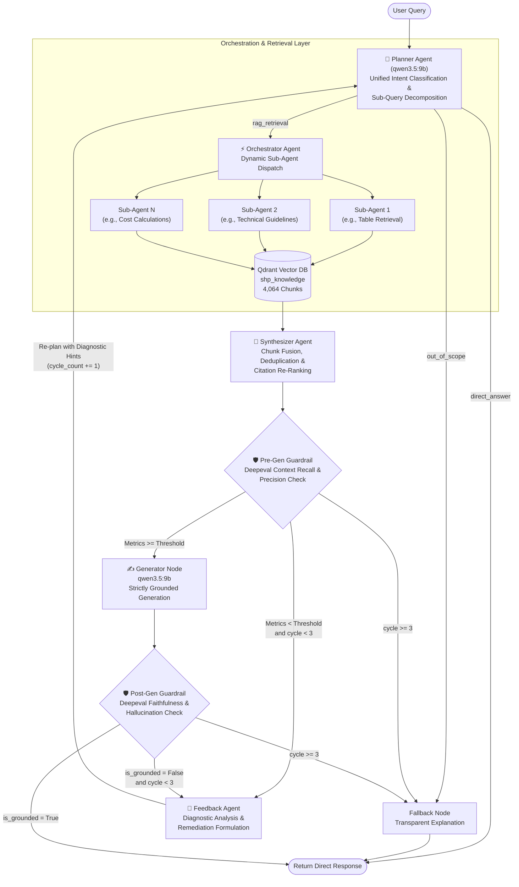

# Agentic RAG — Small Hydropower Plant (SHP) Knowledge System

> An **enterprise-grade, cost-effective Agentic RAG pipeline** for Small Hydropower Plant (SHP) operations, maintenance & knowledge management — built with **LangGraph**, **LangChain**, **Ollama**, and developed using **Spec-Driven Development (SDD)** principles. Fully on-prem capable, no external LLM API dependency.

---

## 📋 Table of Contents

- [1. Overview & Vision](#1-overview--vision)
- [2. Spec-Driven Development (SDD) Methodology](#2-spec-driven-development-sdd-methodology)
- [3. Specifications (The Specs)](#3-specifications-the-specs)
  - [Spec 01: System Requirements & Objectives](#spec-01-system-requirements--objectives)
  - [Spec 02: State Schema & Data Models](#spec-02-state-schema--data-models)
  - [Spec 03: Graph Topology & Node Contracts](#spec-03-graph-topology--node-contracts)
  - [Spec 04: Tools, Retrievers & Integrations](#spec-04-tools-retrievers--integrations)
  - [Spec 05: Guardrails, Fallbacks & Quality Checks](#spec-05-guardrails-fallbacks--quality-checks)
  - [Spec 06: Evaluation & Acceptance Criteria](#spec-06-evaluation--acceptance-criteria)
- [4. Multi-Tier Document Parsing Pipeline](#4-multi-tier-document-parsing-pipeline)
- [5. System Architecture & Workflow](#5-system-architecture--workflow)
- [6. Project Directory Structure](#6-project-directory-structure)
- [7. Setup & Installation](#7-setup--installation)
- [8. Configuration (.env)](#8-configuration-env)
- [9. Development Roadmap](#9-development-roadmap)

---

## 1. Overview & Vision

| Field | Detail |
| :--- | :--- |
| **Goal** | Build an enterprise-grade, cost-effective Agentic RAG pipeline deployable fully on-prem or on any cloud infrastructure — no external LLM API required. |
| **Target Domain** | Small Hydropower Plant (SHP) — operations, maintenance, fault diagnosis & knowledge management. |
| **Data Scale** | ~2 GB corpus: PDF manuals, Word reports, scanned images, plain text, JPEG/PNG drawings. |
| **LLM** | `qwen3:9b` via **Ollama** (local inference, fully air-gapped capable) |
| **Embedding Model** | `Qwen3-Embedding-0.6B` (local, via Ollama or sentence-transformers) |
| **Vector DB** | **QDrant** (self-hosted, persistent, production-grade) |
| **Document Parsing** | **Multi-Tier Smart Parser** — `pymupdf4llm` + `Docling` GPU Vision OCR + `RapidOCR` + Office DOM (`python-pptx`, `python-docx`, `openpyxl`, `xlrd`) |
| **Orchestration** | **LangGraph** (stateful multi-agent graph) + **LangChain** (chains, retrievers, tools) |
| **Language** | Python 3.11+ |
| **Key Capabilities** | Self-healing retries, corrective RAG (CRAG), self-RAG, query rewriting, hallucination detection, multi-agent routing |
| **Evaluation** | **Deepeval** — LLM evaluation framework (faithfulness, answer relevance, context precision/recall) |

---

## 2. Spec-Driven Development (SDD) Methodology

This project follows **Spec-Driven Development (SDD)**: every node, state transition, tool behavior, and routing condition is written as an explicit, frozen contract *before* any code is implemented.

```
┌─────────────────┐       ┌────────────────────┐       ┌───────────────────┐
│  1. SPEC PHASE  │ ───>  │ 2. BUILD PHASE     │ ───>  │ 3. VERIFY PHASE   │
│  State, Graph & │       │ Implement against  │       │ Evals & Tracing   │
│  Node Contracts │       │ frozen contracts   │       │ against metrics   │
\─────────────────/       \────────────────────/       \───────────────────/
```

1. **Specify** — Define typed state schemas, node input/output contracts, and all routing conditions in this README. **Nothing is built until the spec is signed off.**
2. **Implement** — Build discrete LangGraph nodes that strictly match the written contract. No scope creep.
3. **Verify** — Run automated RAGAS evaluations and LangSmith traces to validate every node against acceptance criteria.

> **Rule**: If a behavior is not in the spec, it is not built. If the spec is wrong, the spec is updated first, then the code.

---

## 3. Specifications (The Specs)

### Spec 01: System Requirements & Objectives

#### Functional Requirements

| # | Requirement | Status |
|---|---|---|
| FR-01 | Ingest & parse PDF (native + scanned OCR), DOCX/DOC, PPTX/PPT, XLSX/XLS, TXT, PNG/JPG → Markdown | [x] Operational (54/54 docs, 0 failures) |
| FR-02 | Chunk Markdown into semantic segments and embed with `Qwen3-Embedding-0.6B` | [x] Operational (4,064 chunks, 1024-dim vectors) |
| FR-03 | Store & retrieve vectors from self-hosted QDrant with metadata filtering | [x] Operational (4,064 points, dual-mode engine) |
| FR-04 | **Planner Agent**: Unified Intent Classification (`direct_answer` / `out_of_scope` / `rag_retrieval`), Sub-Query Decomposition with Metadata Filters, and Feedback Absorption | [x] Operational (src/agents/planner/) |
| FR-05 | **Orchestrator Agent & Sub-Agents**: Dynamic dispatch of specialized sub-queries against Qdrant | [ ] Next Step |
| FR-06 | **Synthesizer Agent**: Multi-source chunk fusion, deduplication, and citation re-ranking | [ ] Planned |
| FR-07 | **Pre-Generation Guardrail (Deepeval)**: Contextual Precision, Recall, and Relevancy validation | [ ] Planned |
| FR-08 | **Generator Node**: Grounded final answer generation using `qwen3.5:9b` | [ ] Planned |
| FR-09 | **Post-Generation Guardrail (Deepeval)**: Hallucination detection & Faithfulness grading | [ ] Planned |
| FR-10 | **Feedback Agent**: Diagnostic reflection on low metrics, formulating targeted remediation for Planner | [ ] Planned |
| FR-11 | Fallback Circuit Breaker: Graceful cannot-answer response upon exceeding max retry cycles (3) | [ ] Planned |
| FR-12 | Persistent conversation memory via LangGraph checkpointing (SQLite) | [ ] Planned |

#### Non-Functional Requirements

| # | Requirement | Target |
|---|---|---|
| NFR-01 | End-to-end query latency (p95) | < 5.0s on CPU/local GPU |
| NFR-02 | Faithfulness score (RAGAS) | > 0.90 |
| NFR-03 | Answer Relevance score (RAGAS) | > 0.88 |
| NFR-04 | Context Recall | > 0.85 |
| NFR-05 | Zero dependency on external LLM APIs | ✅ Ollama only |
| NFR-06 | All data stays on-prem; no telemetry | ✅ Air-gap ready |
| NFR-07 | Max query rewrite attempts before fallback | 3 |

---

### Spec 02: State Schema & Data Models

The `AgentState` TypedDict is the **single source of truth** flowing through the entire LangGraph state channel. All nodes read from and write to this state.

```python
# FILE: src/graph/state.py  — FROZEN SPEC (Multi-Agent Architecture)
from typing import Annotated, Any, Literal
from langchain_core.messages import BaseMessage
from langgraph.graph.message import add_messages
from typing_extensions import TypedDict


class DocumentChunk(TypedDict):
    """Represents a single retrieved document chunk with rich citation metadata."""
    chunk_id: str                     # Unique deterministic chunk UUID/string
    content: str                      # Full markdown text of the chunk (with breadcrumbs)
    source_file: str                  # Source filename (e.g. HDP_AHN511.ppt)
    file_type: str                    # Document type (PDF, PPT, DOCX, XLS)
    page_or_slide: int | None         # Page number or slide index
    breadcrumb: str                   # Section path (e.g. Doc > Section > Table)
    is_table: bool                    # Flag indicating structured table data
    score: float                      # Qdrant cosine similarity score


class SubQuery(TypedDict):
    """A decomposed sub-query planned for targeted retrieval."""
    sub_query_id: str                 # Identifier (e.g. "sq_1")
    query_text: str                   # Specific search query
    target_filter: dict[str, Any] | None # Qdrant filter (e.g. {"is_table": "true"})
    rationale: str                    # Why this sub-query was formed


class FeedbackDiagnosis(TypedDict):
    """Structured diagnostic generated by Feedback Agent upon guardrail failure."""
    failure_type: Literal[
        "INSUFFICIENT_RETRIEVAL",      # Low context recall/precision
        "HALLUCINATION_DETECTED",     # Answer contains ungrounded claims
        "OFF_TOPIC_ANSWER"            # Low answer relevancy
    ]
    missing_aspects: list[str]        # Specific engineering facts/tables missing
    critique: str                     # Human-readable explanation of the defect
    remediation_hint: str             # Actionable suggestion for the Planner Agent


class AgentState(TypedDict):
    # ── Core Conversation ──────────────────────────────────────────────
    messages: Annotated[list[BaseMessage], add_messages]  # Chat message history
    query: str                                             # Current active user query
    original_query: str                                    # Unmodified user input

    # ── Planner Decision & Intent ──────────────────────────────────────
    routing_decision: Literal[
        "rag_retrieval",              # Complex technical SHP question requiring RAG
        "direct_answer",              # Conversational greeting or simple factual question
        "out_of_scope"                # Non-SHP / disallowed domain query
    ]

    # ── Planning & Multi-Agent Orchestration ───────────────────────────
    plan: list[str]                   # High-level steps formulated by Planner Agent
    sub_queries: list[SubQuery]       # Decomposed queries for sub-agents
    sub_agent_results: dict[str, list[DocumentChunk]] # Results keyed by sub_query_id

    # ── Synthesis & Fusion ─────────────────────────────────────────────
    documents: list[DocumentChunk]    # Deduplicated, synthesized, and re-ranked chunks
    synthesized_context: str          # Clean context block assembled for LLM generation

    # ── Guardrails & Evaluation Metrics (Deepeval) ─────────────────────
    retrieval_metrics: dict[str, float] # {"precision": 0.88, "recall": 0.91, "relevancy": 0.85}
    generation_metrics: dict[str, float]# {"faithfulness": 0.94, "answer_relevancy": 0.92}
    is_retrieval_valid: bool          # True if pre-gen retrieval metrics pass threshold
    is_grounded: bool                 # True if post-gen faithfulness passes threshold

    # ── Feedback & Self-Correction Loop ────────────────────────────────
    feedback_diagnosis: FeedbackDiagnosis | None # Analysis fed back to Planner
    cycle_count: int                  # Number of full plan-retrieve-evaluate loops (max: 3)

    # ── Final Output ───────────────────────────────────────────────────
    final_response: str               # Final verified answer returned to user
```

---

### Spec 03: Graph Topology & Node Contracts

#### Node Contracts

| Node | Type / Role | Input Fields (State) | Output Fields (State) | Responsibilities & Fallback |
| :--- | :--- | :--- | :--- | :--- |
| `planner` | **Planner Agent** | `query`, `feedback_diagnosis`, `cycle_count` | `routing_decision`, `plan`, `sub_queries`, `final_response` | Unified entry point: classifies intent (`direct_answer`/`out_of_scope`/`rag_retrieval`), decomposes multi-part technical queries into 1–3 `SubQuery` specs with metadata filters, incorporates feedback diagnostics. |
| `orchestrator` | **Orchestrator Agent** | `sub_queries` | `sub_agent_results` | Dispatches retrieval sub-agents concurrently to Qdrant with specific metadata filters (`is_table`, `file_type`). |
| `synthesizer` | **Synthesizer Agent** | `sub_agent_results`, `query` | `documents`, `synthesized_context` | Fuses chunks across all sub-queries, eliminates duplicates, resolves conflicts, and generates cohesive context with citations. |
| `retrieval_guardrail` | Pre-Gen Evaluator | `query`, `documents` | `retrieval_metrics`, `is_retrieval_valid` | Evaluates Context Recall & Precision using Deepeval/self-eval. If invalid → routes to `feedback_agent`. |
| `generator` | Answer Generator | `query`, `synthesized_context` | `final_response` | Synthesizes an authoritative engineering answer strictly from context using `qwen3.5:9b`. |
| `generation_guardrail` | Post-Gen Evaluator | `query`, `final_response`, `documents` | `generation_metrics`, `is_grounded` | Evaluates Faithfulness and Hallucination metrics. If ungrounded → routes to `feedback_agent`. |
| `feedback_agent` | **Feedback Agent** | `query`, `retrieval_metrics`, `generation_metrics`, `cycle_count` | `feedback_diagnosis`, `cycle_count` | Diagnoses defect root cause, formulates actionable query remediation, increments `cycle_count`. If `cycle_count >= 3` → routes to `fallback`. |
| `fallback` | Circuit Breaker | `original_query`, `feedback_diagnosis` | `final_response` | Formulates transparent, helpful "cannot answer" message detailing what specific data was missing. |

#### Routing & Conditional Edges

```
START                     ──> planner

planner → "direct_answer" ──> END (returns direct answer immediately)
planner → "out_of_scope"  ──> fallback (returns polite domain refusal)
planner → "rag_retrieval" ──> orchestrator

orchestrator              ──> synthesizer
synthesizer               ──> retrieval_guardrail

retrieval_guardrail → is_retrieval_valid = True                     ──> generator
retrieval_guardrail → is_retrieval_valid = False AND cycle_count < 3 ──> feedback_agent
retrieval_guardrail → is_retrieval_valid = False AND cycle_count >= 3 ──> fallback

generator                 ──> generation_guardrail

generation_guardrail → is_grounded = True                            ──> END (Return response)
generation_guardrail → is_grounded = False AND cycle_count < 3      ──> feedback_agent
generation_guardrail → is_grounded = False AND cycle_count >= 3     ──> fallback

feedback_agent            ──> planner (re-plan with diagnostic guidance)
```

---

### Spec 04: Tools, Retrievers & Integrations

| Component | Choice | Config |
| :--- | :--- | :--- |
| **LLM** | `qwen3.5:9b` via Ollama | `base_url: http://localhost:11434`, `temperature: 0.0` for graders, `0.3` for generation |

| **Embedding Model** | `Qwen3-Embedding-0.6B` via Ollama | `model: qwen3-embedding:0.6b`, `dim: 1024` |
| **Vector Store** | QDrant (self-hosted) | `host: localhost`, `port: 6333`, `collection: shp_knowledge` |
| **Document Parser** | Docling | Input: PDF, DOCX, TXT, JPEG, PNG → Output: Markdown |
| **Text Splitter** | `RecursiveCharacterTextSplitter` (Markdown-aware) | `chunk_size: 1000`, `chunk_overlap: 150` |
| **Retriever** | QDrant vector search | `top_k: 6`, `score_threshold: 0.65` |
| **Checkpointing** | `langgraph-checkpoint-sqlite` | `db_path: ./data/checkpoints.db` |
| **External Tools** | None (on-prem only) | Web search disabled for air-gap mode |

---

### Spec 05: Guardrails, Quality Checks & Feedback Agent

#### 1. Pre-Generation Guardrail (Retrieval Evaluation)
- **Mechanism**: LLM-as-judge (Deepeval / local JSON structured eval) using `qwen3.5:9b`.
- **Inputs**: `query` + `sub_queries` + `documents` (synthesized retrieved context).
- **Evaluated Metrics**:
  - `Contextual Precision` (Target ≥ 0.85): Checks whether retrieved chunks are relevant to the specific technical sub-queries.
  - `Contextual Recall` (Target ≥ 0.85): Checks whether all facets of the query plan are covered by the chunks.
- **Decision Contract**:
  - If both metrics ≥ 0.85 → `is_retrieval_valid = True` → Route to `generator`.
  - Else → `is_retrieval_valid = False` → Route to `feedback_agent`.

#### 2. Post-Generation Guardrail (Answer Groundedness Evaluation)
- **Mechanism**: LLM-as-judge using `qwen3.5:9b` with chain-of-thought verification.
- **Inputs**: `query` + `final_response` + `documents`.
- **Evaluated Metrics**:
  - `Faithfulness` (Target ≥ 0.90): Every factual statement, formula, numerical value, or turbine parameter must be explicitly supported by context.
  - `Answer Relevancy` (Target ≥ 0.88): The answer directly answers the engineering intent without extraneous drift.
- **Decision Contract**:
  - If Faithfulness ≥ 0.90 and Answer Relevancy ≥ 0.88 → `is_grounded = True` → Route to `END` (deliver to user).
  - Else → `is_grounded = False` → Route to `feedback_agent`.

#### 3. Feedback Agent (Reflection & Remediation Engine)
- **Role**: Rather than a blind re-try, the Feedback Agent acts as a diagnostic inspector when any guardrail fails.
- **Inputs**: Current `query`, `retrieval_metrics`, `generation_metrics`, and `cycle_count`.
- **Outputs**: Pydantic structured `FeedbackDiagnosis`:
  ```json
  {
    "failure_type": "INSUFFICIENT_RETRIEVAL | HALLUCINATION_DETECTED | OFF_TOPIC_ANSWER",
    "missing_aspects": ["Specific discharge data for monsoon months", "CEA environmental norms"],
    "critique": "Retrieved chunks cover turbine heads but completely lack the environmental flow guidelines requested.",
    "remediation_hint": "Formulate a dedicated sub-query for CEA environmental flow regulations with PDF keyword filter."
  }
  ```
- **Action**: Passes `FeedbackDiagnosis` back to the `planner` node and increments `cycle_count`.
- **Circuit Breaker**: If `cycle_count >= 3`, terminates loop to avoid infinite execution and routes to `fallback`.


---

### Spec 06: Evaluation & Acceptance Criteria

#### Evaluation Framework
- **Primary**: [Deepeval](https://github.com/confident-ai/deepeval) — LLM evaluation framework with built-in RAG metrics, runs locally
- **Tracing**: LangSmith (optional, for development trace inspection)

#### Deepeval Metrics Used

| Deepeval Metric | Class | Target | Description |
| :--- | :--- | :--- | :--- |
| Faithfulness | `FaithfulnessMetric` | ≥ 0.90 | Answer is grounded in retrieved context |
| Answer Relevancy | `AnswerRelevancyMetric` | ≥ 0.88 | Answer directly addresses the query |
| Contextual Precision | `ContextualPrecisionMetric` | ≥ 0.85 | Retrieved chunks are ranked correctly |
| Contextual Recall | `ContextualRecallMetric` | ≥ 0.85 | Retrieved chunks cover the expected answer |
| Contextual Relevancy | `ContextualRelevancyMetric` | ≥ 0.80 | Retrieved chunks are relevant to the query |
| Query Latency (p95) | Custom timer | < 5.0s | End-to-end response time |
| Fallback Rate | Custom counter | < 10% | % of queries hitting the fallback node |

#### Acceptance Gate
A build is **not promoted** unless all 7 metrics above meet their targets on the SHP golden test set (minimum 50 hand-labeled `LLMTestCase` objects from the corpus).

```python
# FILE: src/evals/run_deepeval.py — evaluation entry point
from deepeval import evaluate
from deepeval.metrics import (
    FaithfulnessMetric,
    AnswerRelevancyMetric,
    ContextualPrecisionMetric,
    ContextualRecallMetric,
    ContextualRelevancyMetric,
)
from deepeval.test_case import LLMTestCase

METRICS = [
    FaithfulnessMetric(threshold=0.90, model="ollama/qwen3:9b"),
    AnswerRelevancyMetric(threshold=0.88, model="ollama/qwen3:9b"),
    ContextualPrecisionMetric(threshold=0.85, model="ollama/qwen3:9b"),
    ContextualRecallMetric(threshold=0.85, model="ollama/qwen3:9b"),
    ContextualRelevancyMetric(threshold=0.80, model="ollama/qwen3:9b"),
]
```

---

## 4. Multi-Tier Document Parsing Pipeline (Operational)

The ingestion pipeline ([`src/ingestion/parser.py`](file:///d:/GenAi_Code/Agentic_RAG/src/ingestion/parser.py)) implements an enterprise-grade, **3-tier smart routing architecture** designed to maximize extraction fidelity (preserving Markdown headings, tables, and lists), eliminate OCR hallucination on digital text, and selectively engage GPU/CPU OCR only where visual elements or scans require it.

### Routing Architecture

```mermaid
flowchart TD
    Input([Input Document in data/raw/]) --> HashCheck{SHA-256 Hash\nin data/parsed/?}
    HashCheck -->|Cache Hit & not --force| Cached[Load Cached .md\nSkip Parsing]
    HashCheck -->|New or --force| RouteExt{Inspect File\nExtension}

    %% Plain Text
    RouteExt -->|.txt / .md| PlainText[Direct UTF-8 Reader]

    %% Office Docs
    RouteExt -->|.docx| DocxParser[python-docx + Embedded RapidOCR]
    RouteExt -->|.doc| DocCOM[Windows Word COM Automation]

    %% Presentations
    RouteExt -->|.pptx| PPTXParser[python-pptx DOM Parser\nNative Tables + Text]
    RouteExt -->|.ppt| PPTCOM[PowerPoint COM Conversion\n.ppt ──> .pptx]
    PPTCOM --> PPTXParser
    PPTXParser --> PPTImgCheck{Slide has Images\nor Scans?}
    PPTImgCheck -->|Image-only slide <30 chars| SlideOCR[RapidOCR Full Slide Body]
    PPTImgCheck -->|Digital text + Diagram| DiagramOCR[RapidOCR Diagram Blockquote]
    PPTImgCheck -->|No images| SlideClean[Clean Markdown Output]

    %% Spreadsheets
    RouteExt -->|.xlsx| XlsxParser[openpyxl ──> GFM Markdown Tables\n+ Embedded RapidOCR]
    RouteExt -->|.xls| XlsParser[xlrd ──> GFM Markdown Tables\n+ Embedded RapidOCR]

    %% PDFs
    RouteExt -->|.pdf| PDFProbe[PyMuPDF4LLM Fast-Path Probe]
    PDFProbe --> PDFCharCheck{Alphanumeric chars\nacross all pages > 80?}
    PDFCharCheck -->|Yes: Digital PDF| PyMuPDFOut[Structured Markdown Tables & Headings\n~0.2s/doc]
    PDFCharCheck -->|No: Scanned PDF| DoclingGPU[Docling + PyPdfium Backend\n+ EasyOCR on NVIDIA RTX 5050 GPU]

    %% Standalone Images
    RouteExt -->|.png / .jpg / .jpeg| DoclingGPU

    %% Output
    PlainText --> OutMd[data/parsed/{stem}__{hash}.md]
    DocxParser --> OutMd
    DocCOM --> OutMd
    SlideOCR --> OutMd
    DiagramOCR --> OutMd
    SlideClean --> OutMd
    XlsxParser --> OutMd
    XlsParser --> OutMd
    PyMuPDFOut --> OutMd
    DoclingGPU --> OutMd

    OutMd --> MetaIndex[Upsert data/parsed/metadata.json]
```

---

### Format-by-Format Extraction Strategy

| File Type | Extensions | Primary Engine | OCR Engine & Mode | Table Extraction Quality | Speed |
| :--- | :--- | :--- | :--- | :--- | :--- |
| **Digital PDF** | `.pdf` | `pymupdf4llm` (C++ fitz) | Selective (image crops only) | Native GFM Markdown tables (`\| ... \|`) | **~0.2s–0.5s** / doc |
| **Scanned PDF** | `.pdf` | `Docling` (`PyPdfiumDocumentBackend`) | **EasyOCR on CUDA GPU** (NVIDIA RTX 5050, `sm_120`) | Layout transformer table recovery | **~5s–15s** / doc |
| **PowerPoint** | `.pptx`, `.ppt` | `python-pptx` (via COM for `.ppt`) | **RapidOCR** (selective per-image & image-only slides) | Native GFM Markdown tables (`\| ... \|`) | **~1s–5s** / doc |
| **Word Document** | `.docx`, `.doc` | `python-docx` / Word COM | **RapidOCR** (on embedded figures/charts) | Native GFM Markdown tables (`\| ... \|`) | **~0.5s–1.5s** / doc |
| **Excel Workbook** | `.xlsx`, `.xls` | `openpyxl` / `xlrd` | **RapidOCR** (on embedded charts/drawings) | Native GFM Markdown tables (`\| ... \|`) | **~0.05s–0.2s** / doc |
| **Standalone Images** | `.png`, `.jpg`, `.jpeg` | `Docling` / `EasyOCR` | Full-image OCR (GPU/CPU) | Visual table recognition | **~2s–5s** / image |
| **Plain Text** | `.txt`, `.md` | Direct UTF-8 stream | None | Preformatted Markdown | **< 0.01s** |

---

### Detailed Technical Implementations

#### 1. PDFs: Digital Fast-Path with Scanned GPU Fallback
- **Digital Fast-Path**: Uses `pymupdf4llm` to convert digital vector PDFs directly into clean Markdown. Preserves structural headings (`#`, `##`, `###`), bold text, bullet points, and converts vector-drawn and text-delimited tables into standard GitHub-Flavored Markdown tables.
- **Scanned Detection Probe**: Calculates the clean alphanumeric character count across all pages. If fewer than 80 characters are detected, it classifies the file as a scanned document or blueprint and engages the GPU vision pipeline.
- **GPU Docling Vision OCR**:
  - Configured with `PyPdfiumDocumentBackend` (Google Chromium PDFium engine) for native crash-proof stability on Windows.
  - Accelerated via PyTorch CUDA 12.8 (`cu128`) on the **NVIDIA GeForce RTX 5050 Laptop GPU (8GB VRAM, Blackwell `sm_120`)**.
  - Runs vision layout models + EasyOCR for multi-column text restoration and scanned table grid reconstruction.

#### 2. PowerPoint (`.pptx` & `.ppt`): Native Tables + Selective OCR
- **Native Table Integrity**: Extracts structured tables directly from PowerPoint's internal shape tree (`shape.has_table`). Every row and cell is mapped to a Markdown table with header dividers, preserving numeric data (MW, kW, tariffs, flow rates) without OCR distortion.
- **Smart Selective OCR**:
  - **Image-Only Slides**: If a slide contains virtually no digital text (< 30 characters) and no table (e.g. a scanned slide or photograph), RapidOCR transcribes the image and formats the text as the primary slide body.
  - **Embedded Diagrams & Flowcharts**: If a slide has digital text *plus* embedded charts, schematics, or maps, RapidOCR transcribes the visual text and appends it cleanly in a blockquote:
    ```markdown
    > **[Slide 13 Image/Diagram OCR]**: Day of Year NATURAL FLOW PATTERN Flood River Flow Natural High Flows
    ```
- **Legacy `.ppt` COM Bridge**: Uses Windows PowerPoint COM automation (`win32com.client`) in headless mode (`WithWindow=False`) to convert legacy binary `.ppt` files to `.pptx` in-memory before parsing, ensuring legacy presentations receive identical table and text fidelity.

#### 3. Excel Spreadsheets (`.xlsx` & `.xls`): Worksheets to Tables
- **`.xlsx`**: Processed via `openpyxl` with `data_only=True` to capture computed cell values rather than raw formula strings.
- **`.xls`**: Processed via `xlrd` for legacy binary workbooks.
- Converts all active worksheets into dedicated Markdown sections (`## Sheet: SheetName`) followed by GFM Markdown tables with proper column alignment.
- Worksheet drawings and floating chart objects are inspected and OCR'd via RapidOCR.

#### 4. Word Documents (`.docx` & `.doc`):
- Modern `.docx` files extract heading styles, bullet hierarchies, and table grids via `python-docx`. Embedded `r:embed` image streams in document parts are inspected and OCR'd.
- Legacy `.doc` files extract formatted text via Windows Word COM automation (`win32com.client.Dispatch("Word.Application")`).

#### 5. Hardware & Process Optimization:
- **GPU (RTX 5050 via CUDA 12.8)**: Dedicated exclusively to heavy vision models (Docling layout transformers, scanned PDF EasyOCR, and upcoming Qwen3 vector embeddings) to prevent VRAM fragmentation.
- **CPU (Multi-Threaded ONNX Runtime with AVX2)**: RapidOCR (PP-OCRv6 engine, ~15MB weights) runs on multi-core CPU, achieving 0.3s–0.5s per image with zero GPU memory contention.

---

### Ingestion CLI Commands

```powershell
# Parse all supported documents in data/raw/ (skips already-parsed files via SHA-256 cache)
python -m src.ingestion.parser

# Force re-parse all documents (overwriting data/parsed/)
python -m src.ingestion.parser --force

# Force re-parse only PowerPoint presentations
python -m src.ingestion.parser --force --ext .pptx .ppt

# Force re-parse Word and Excel files
python -m src.ingestion.parser --force --ext .docx .doc .xlsx .xls

# Run with custom directories and parallel workers
python -m src.ingestion.parser --raw-dir ./data/raw --parsed-dir ./data/parsed --workers 2
```

---

### Markdown-Aware Semantic Chunking (`src/ingestion/chunker.py`)

The chunking pipeline ([`src/ingestion/chunker.py`](file:///d:/GenAi_Code/Agentic_RAG/src/ingestion/chunker.py)) is specifically engineered for high-precision technical retrieval and optimized for smaller/local LLMs (`qwen3:9b`):

1. **Context Breadcrumb Injection**:
   - Every chunk automatically inherits its complete document hierarchy (e.g. `[Source: Madkini flood peak report.doc | Location: Slide/Page 3 | Section: Flood Frequency Analysis > Gumbel Distribution]`).
   - Prepending this context ensures that local models immediately understand what project, river, or clause a technical excerpt refers to, eliminating retrieval ambiguity.
2. **Atomic Table Protection**:
   - Markdown tables (`| ... |`) are identified and kept unbroken within a single chunk whenever possible.
   - For giant tables exceeding token limits, the table is split row-by-row while **repeating the column header row on every split chunk**, ensuring every chunk remains a valid, readable Markdown table.
3. **Slide Boundary Preservation**:
   - Presentation slides (`## Slide {i}`) are preserved as distinct contextual units.
4. **Token Budgeting via Tiktoken**:
   - Exact token counts are computed using `tiktoken` (`cl100k_base`), maintaining chunks around **~330 tokens** (well within `Qwen3-Embedding-0.6B`'s sweet spot).

#### Chunk Metadata Payload (For Citations)
```json
{
  "chunk_id": "HDP_AHN511__9fe0f668__c0002",
  "source_file": "HDP_AHN511.ppt",
  "file_type": "PPT",
  "document_title": "HDP_AHN511",
  "breadcrumb": "HDP_AHN511 > Slide 1: Dynamic Pricing of electrical power",
  "section_hierarchy": ["HDP_AHN511", "Slide 1: Dynamic Pricing of electrical power"],
  "page_or_slide": 1,
  "chunk_index": 2,
  "total_chunks": 36,
  "is_table": false,
  "char_count": 482,
  "token_count": 121
}
```

#### Chunking CLI Commands
```powershell
# Chunk all parsed documents in data/parsed/ (outputs to data/chunks/chunks.jsonl)
python -m src.ingestion.chunker

# Customize chunk size and overlap
python -m src.ingestion.chunker --max-chars 1800 --overlap-chars 150
```

---

### 4.2 Vector Embedding Pipeline (`qwen3-embedding:0.6b`)

The vector embedding engine ([`src/ingestion/embedder.py`](file:///d:/GenAi_Code/Agentic_RAG/src/ingestion/embedder.py)) translates semantic chunk texts into high-density 1024-dimensional continuous representations using local Ollama.

#### Model Selection Rationale
- **Model**: `qwen3-embedding:0.6b` (639 MB manifest).
- **Vector Dimension**: `1024` floats per vector.
- **VRAM Footprint**: ~640 MB VRAM, co-existing comfortably alongside `qwen3.5:9b` within the 8 GB VRAM budget of the NVIDIA GeForce RTX 5050 Laptop GPU.
- **Multilingual & Domain Breadth**: Outstanding semantic density across technical engineering concepts (hydrology, hydro-mechanical turbine envelopes, civil structures, Indian Central Electricity Authority regulatory guidelines).

#### Technical Specifications & Reliability
1. **Ollama Batch API Endpoint**: Interacts with `http://127.0.0.1:11434/api/embed` passing multi-text arrays (`batch_size=32`), drastically cutting HTTP request overhead compared to single-item endpoints.
2. **Incremental Checkpointing**: Reads existing `data/embeddings/embedded_chunks.jsonl` upon startup; already-embedded `chunk_id`s are skipped automatically, preventing redundant recomputation during interrupted runs.
3. **Resilient Retry Protocol**: Implements exponential backoff retries (`2^attempt` second backoff) to smoothly absorb transient Ollama GPU memory re-allocations.
4. **Execution Performance**:
   - **Total Chunks Embedded**: **4,064**
   - **Throughput**: **21.5 chunks/second** (189.37 seconds total runtime)
   - **Failures / Drops**: **0**

```powershell
# Generate embeddings for all chunks in data/chunks/chunks.jsonl
python -m src.ingestion.embedder --batch-size 32

# Re-embed from scratch (dropping cache)
python -m src.ingestion.embedder --force
```

---

### 4.3 Qdrant Vector Indexing & Hybrid Retrieval Engine

The vector indexer ([`src/ingestion/indexer.py`](file:///d:/GenAi_Code/Agentic_RAG/src/ingestion/indexer.py)) ingests embedded chunks into the `shp_knowledge` Qdrant collection for high-speed similarity search and payload filtering.

#### Architecture Highlights
1. **Zero-Dependency Dual Mode**:
   - **Server Mode**: Probes `http://127.0.0.1:6333`. Connects to a live Qdrant container if running.
   - **Embedded Disk Mode (Fallback)**: If no server daemon is running, seamlessly launches an embedded local disk engine storing data in `data/qdrant_db/`. No Docker or background service required.
2. **Deterministic UUID5 Identifiers**:
   - Every chunk ID (e.g. `HDP_AHN511__9fe0f668__c0002`) maps to a deterministic UUID via `uuid5(NAMESPACE_SHP, chunk_id)`.
   - Guaranteed idempotent upserts: Running indexer repeatedly never generates duplicate points or phantom vectors.
3. **Rich Metadata Payload Indexing**:
   - Payload attributes indexed for pre-filtering: `file_type`, `is_table`, `source_file`, `page_or_slide`.
   - Full citation text preserved: `content`, `breadcrumb`, `document_title`, `token_count`.
4. **Indexing Benchmarks**:
   - **Total Indexed Points**: **4,064**
   - **Upsert Speed**: **199.3 points/second** (completed in 20.39 seconds)
   - **Distance Metric**: **Cosine**

#### CLI & Verification Commands
```powershell
# Index embedded chunks into Qdrant collection 'shp_knowledge'
python -m src.ingestion.indexer --batch-size 128

# Recreate collection from scratch
python -m src.ingestion.indexer --recreate

# Test semantic query retrieval with top-3 formatted citations
python -m src.ingestion.indexer --query "Kaplan turbine efficiency curve and cavitation limits" --top-k 3

# Test structured table-only filtering
python -m src.ingestion.indexer --query "hydrological discharge flow data" --filter-table --top-k 3
```

---

## 5. System Architecture & Workflow

The architecture operates as a **Plan-Orchestrate-Synthesize-Guard-Reflect Multi-Agent Lifecycle**:



---

## 6. Project Directory Structure

```text
Agentic_RAG/
├── src/
│   ├── prompts/
│   │   ├── planner_agent_system.jinja2   # Planner Agent system prompt
│   │   ├── planner_agent_user.jinja2     # Planner Agent user prompt + few-shots
│   │   ├── synthesizer_system.jinja2     # Synthesizer Agent system prompt
│   │   ├── generator_system.jinja2       # Grounded Generator system prompt
│   │   └── feedback_system.jinja2        # Feedback diagnostic system prompt
│   ├── states/
│   │   ├── planneragent_state.py         # Planner Agent TypedDict & Pydantic models
│   │   ├── orchestrator_state.py         # Orchestrator sub-agent state schemas
│   │   └── agent_state.py                # Global unified AgentState
│   ├── agents/
│   │   ├── planner/
│   │   │   ├── agentnodes.py             # Planner node (Jinja2 + Ollama qwen3.5:9b)
│   │   │   ├── agentgraph.py             # Planner LangGraph StateGraph
│   │   │   └── planner.py                # Public facade API
│   │   ├── orchestrator/
│   │   │   ├── agentnodes.py             # Sub-agent dispatch & Qdrant retrieval
│   │   │   └── agentgraph.py             # Orchestrator LangGraph workflow
│   │   ├── synthesizer/
│   │   │   ├── agentnodes.py             # Fusion, deduplication & citation re-ranking
│   │   │   └── agentgraph.py             # Synthesizer LangGraph workflow
│   │   └── feedback/
│   │       ├── agentnodes.py             # Diagnostic reflection on guardrail failures
│   │       └── agentgraph.py             # Feedback Agent workflow
│   ├── ingestion/
│   │   ├── parser.py                     # Smart Multi-Tier Document Parser (Operational)
│   │   ├── chunker.py                    # Markdown-aware semantic text splitting (Operational)
│   │   ├── embedder.py                   # Qwen3-Embedding-0.6B via Ollama (Operational)
│   │   └── indexer.py                    # QDrant collection manager & upsert (Operational)
│   ├── evals/
│   │   ├── golden_dataset.json           # Hand-labeled SHP QA pairs (LLMTestCase format)
│   │   └── run_deepeval.py               # Deepeval evaluation runner
│   └── main.py                           # CLI entry point
├── data/
│   ├── raw/                              # Raw SHP documents (PDF, DOCX, PPTX, XLS, etc.)
│   ├── parsed/                           # Structured Markdown output + metadata.json
│   ├── chunks/                           # Semantic chunks JSONL + summary
│   ├── embeddings/                       # 1024-dim vectors JSONL + summary
│   ├── qdrant_db/                        # Local embedded Qdrant vector store
│   └── checkpoints.db                    # LangGraph SQLite checkpoint store
├── .env.example                          # Environment variable template
├── pyproject.toml                        # uv project dependencies
└── README.md                             # This file — Project spec & documentation
```

---

## 7. Setup & Installation

### Prerequisites
- Python `>= 3.11`
- [uv](https://github.com/astral-sh/uv) (fast Python package manager)
- [Ollama](https://ollama.com/) installed and running
- [QDrant](https://qdrant.tech/) running locally (Docker recommended)

### 1. Pull Ollama Models
```powershell
ollama pull qwen3.5:9b
ollama pull qwen3-embedding:0.6b
```

### 2. Start QDrant (Docker)
```powershell
docker run -d --name qdrant -p 6333:6333 -p 6334:6334 -v qdrant_storage:/qdrant/storage qdrant/qdrant
```

### 3. Install Python Dependencies
```powershell
# Create & sync virtual environment
uv venv
.\.venv\Scripts\activate
uv sync
```

### 4. Run Ingestion Pipeline (One-Time Setup)
```powershell
# 1. Parse all 54 raw documents (PDF, DOCX, PPTX, XLS) to structured Markdown
python -m src.ingestion.parser

# 2. Chunk Markdown into semantic segments with breadcrumb headers
python -m src.ingestion.chunker

# 3. Generate 1024-dim embeddings via Ollama qwen3-embedding:0.6b
python -m src.ingestion.embedder --batch-size 32

# 4. Index points into Qdrant vector database (embedded local or server)
python -m src.ingestion.indexer --recreate

# 5. Verify vector retrieval
python -m src.ingestion.indexer --query "Kaplan turbine efficiency curve" --top-k 3
```

### 5. Run the Agent
```powershell
python src/main.py chat
```

---

## 8. Configuration (.env)

Copy `.env.example` to `.env`:
```powershell
Copy-Item .env.example .env
```

Key variables:

```env
# Ollama
OLLAMA_BASE_URL=http://localhost:11434
OLLAMA_LLM_MODEL=qwen3.5:9b
OLLAMA_EMBED_MODEL=qwen3-embedding:0.6b

# QDrant
QDRANT_HOST=localhost
QDRANT_PORT=6333
QDRANT_COLLECTION=shp_knowledge

# Retrieval
RETRIEVER_TOP_K=6
RETRIEVER_SCORE_THRESHOLD=0.65

# Self-healing limits
MAX_REWRITE_ATTEMPTS=3
MAX_GENERATION_ATTEMPTS=2

# LangSmith (optional — for tracing during development)
LANGCHAIN_TRACING_V2=false
LANGCHAIN_API_KEY=
LANGSMITH_PROJECT=agentic-rag-shp
```

---

## 9. Development Roadmap

| Phase | Description | Status |
|---|---|---|
| **Phase 0: Spec Freeze** | Finalize all 6 specs in this README; review & sign off | ✅ Complete |
| **Phase 1: Ingestion Pipeline** | Multi-Tier Document Parser (54/54) → Semantic Chunker (4,064 chunks) → Embedder (qwen3-embedding) → Qdrant Indexer | ✅ Complete (4,064 pts indexed) |
| **Phase 2: Planner Agent** | Unified Intent Classification (`direct_answer` / `out_of_scope` / `rag_retrieval`), Sub-Query Decomposition, and Feedback Absorption (`src/agents/planner/`) | ✅ Complete & Verified |
| **Phase 3: Orchestrator Agent & Sub-Agents** | Dynamic dispatch of specialized sub-queries against Qdrant (`src/agents/orchestrator/`) | 🔄 Next Step |
| **Phase 4: Synthesizer Agent** | Multi-source chunk fusion, deduplication, and citation re-ranking (`src/agents/synthesizer/`) | [ ] Planned |
| **Phase 5: Dual Guardrails & Feedback Loop** | Deepeval Pre-Gen Recall/Precision Guardrail + Grounded Generator (`qwen3.5:9b`) + Post-Gen Faithfulness Guardrail + Diagnostic Feedback Agent | [ ] Planned |
| **Phase 6: Graph Wiring & Memory** | Connect LangGraph StateGraph, conditional edges, cycle counter circuit breaker, and SQLite checkpointing | [ ] Planned |
| **Phase 7: Evaluation Benchmark & CLI** | Build 50+ golden `LLMTestCase` dataset; run Deepeval benchmarks against Spec 06 criteria; rich interactive CLI | [ ] Planned |